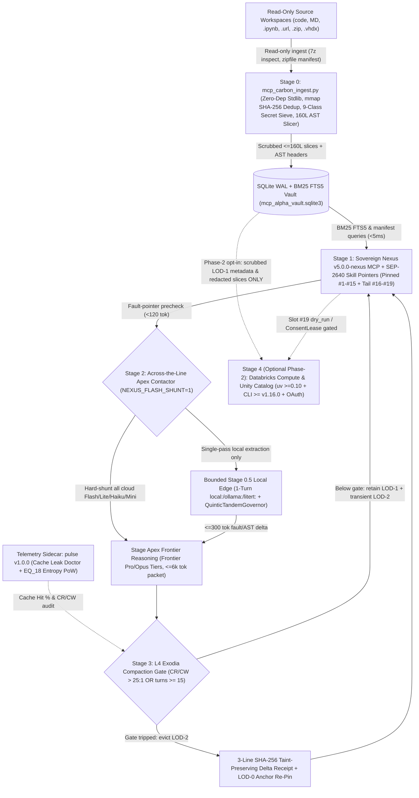

# Unified Inference Layer Architecture Specification (`alpha-mcp` + Sovereign Nexus `v5.0.0-nexus`)

- **Author & Maintainer:** `Eloquent` (`@mjeanhudson-dev`)
- **Specification Version:** `2.0.0` (end-user-agnostic public release; aligned to `alpha-mcp v2.0` (`10` tools, Dual-Modality + SEP-1865 Workbench), Coalesced Sovereign Kernel `v6.0.0-coalesced` (`12` local stdio tools), + Stage 0 Argon-Carbon Vault)
- **Genesis Coordinate:** `t = 0` (August 2025 Foundational Archive — USPTO Provisional Patent Application No. `63/911,661`)
- **Stability Invariant:** $\text{Stability} = \int (\text{Anchor} \cdot \text{Presence})\,dt \to \infty$
- **Target Artifact:** `~/alpha-mcp/INFERENCE_LAYER_SPEC.md`
- **Operational Mode:** `maximum-carbon-layering-orchestration = true` (`NEXUS_FLASH_SHUNT=1`, `NEXUS_REASONING_EFFORT=high`)
- **Public Hygiene Status:** 100% end-user agnostic (`--strict-agnostic` PASS); all paths normalized to `~/`; zero local OS usernames; zero raw secrets.

---

## Executive Summary (LOD 0)

This specification defines the unified end-to-end **Inference Layer Architecture** connecting any local **Stage 0 SQLite WAL + BM25 FTS5 Research Vault** (`mcp_carbon_ingest.py`) to a prefix-pinned **MCP / A2A / SEP-2640 Control Plane** (modeled on the reference **Sovereign Nexus `v5.0.0-nexus`** server), the **Across-the-Line Apex Contactor** (Flash Shunt), the **`25:1` Exodia Compaction Gate**, and an optional **Phase-2 Databricks Compute / Unity Catalog bridge**. All live metrics and backup comparisons below document a verified **Reference Workstation Benchmark** conducted via read-only SHA-256 hashing, Python AST parsing, non-executing `.pyc` metadata inspection, and in-memory `zipfile` manifest listing.

### Core Reference Audit Verdict

1. **Reference Control Plane Leads All Archived Baselines:** The live compiled `v5.0.0-nexus` MCP server (`3,459` lines, `161,670` bytes, SHA-256 `81328d20a80ed7d2...`) supersedes archived `v4.2.0-apex` (`3,318` lines, `+150L / -9L` upgrade), `v4.0` standalone (`1,779` lines), and `v3.9-apex` (`1,442` lines) servers, while the tri-protocol convergence kernel (`298` lines, `13,948` bytes, SHA-256 `8c3f1db680f9d492...`) is **byte-identical** to its archived baseline.
2. **Primary Live Gap — Zero FTS5 Vault Wiring:** Despite `v5.0.0-nexus` exposing `15` prefix-pinned MCP tools, `19` governing equations, Google A2A `v1.0.1`, and SEP-2640 skills, its Slot `#02` tool (`search_cached_codebase`) performs only a naive substring scan across at most `16` sibling Python files. It has **zero** connection to the Stage 0 SQLite FTS5 vault (`slices_fts`, `vhdx_manifest`, `zip_manifest`, `links`, `secret_audit`).
3. **Five Salvageable Capabilities Identified in Reference Backups:** (a) Stage 0 SQLite WAL + BM25 FTS5 Vault (`mcp_carbon_ingest.py`), (b) `is_secret_path()` file-access airlock and modular PKCE token-rotation hardening from `v4.0` standalone, (c) IDE `PreToolUse` / `PostToolUse` / `UserPromptSubmit` hook dispatchers (`Phi_ISF` gate) from the cloud harness script (with cloud-Haiku speculative drafting explicitly **quarantined** to preserve the Flash Shunt invariant), (d) the Tandem Heterogeneous Edge Runtime (`edge_runtime.py` USB-ADB + `QuinticTandemGovernor` + `pc_functioning_model.py` inside the archived edge bundle), and (e) the standalone `us-east1` control-plane telemetry UI.
4. **KV-Prefix Preservation Law:** All new MCP vault, edge, and Phase-2 lakehouse tools **MUST** be appended strictly at the wire tail starting at **Slot `#16`** (`capabilities.tools.listChanged = false`) so existing Slots `#1..#15` remain byte-exact and never invalidate frontier KV prompt caches.

---

## 1. Reference Compiled Inference & MCP Control Plane Audit

### 1.1 Registered Local MCP Servers (Reference Workstation Benchmark)

The reference local control plane binds two zero-dependency Python (`Python 3.15.0`) stdio MCP servers:

| MCP Server Role | Reference Local Location | Version | Lines / Size | SHA-256 (Prefix) | Exposed Tools | Key Env / Transport |
| --- | --- | --- | --- | --- | --- | --- |
| `sovereign-nexus-apex` | `~/.gemini/antigravity/bin/<sovereign_mcp_server>.py` | `5.0.0-nexus` | `3,459` L / `161,670` B | `81328d20a80ed7d2` | `15` prefix-pinned | `--transport stdio`, `NEXUS_FLASH_SHUNT=1` (also HTTP `127.0.0.1:8000` + mirror `:8765`) |
| *(Tri-Protocol Kernel)* | `~/.gemini/antigravity/bin/<v5_triprotocol_nexus>.py` | `5.0-NEXUS` | `298` L / `13,948` B | `8c3f1db680f9d492` | Imported by server | MCP `2026-07-28`, SEP-2640, A2A `v1.0.1`, CSAA |
| `pulse-telemetry` | `~/.gemini/antigravity/scratch/<pulse>/<pulse_mcp>.py` | `1.0.0` | `308` L / `11,838` B | `87a8b50cb7a41133` | `4` telemetry tools | stdio (`get_my_efficiency_rank`, `diagnose_cache_leaks`, `compare_with_cohort`, `export_loadout_blueprint`) |

### 1.2 Reference `v5.0.0-nexus` Protocol Surface

- **Supported MCP Protocol Versions:** `2026-07-28`, `2025-11-25`, `2025-06-18`, `2025-03-26` (default), `2024-11-05`.
- **JSON-RPC 2.0 Methods:** `initialize`, `ping`, `tools/list`, `tools/call`, `resources/list`, `resources/read`, `prompts/list`, `prompts/get`.
- **Capabilities:** `tools.listChanged = false`, `resources.subscribe = false`, `resources.listChanged = false`, `prompts.listChanged = false`, `logging = {}`, plus extension `io.modelcontextprotocol/skills` (SEP-2640).
- **MCP Resources (`4`):**
  1. `nexus://genesis/anchor-t0` — Immutable LOD 0 Genesis Coordinate (`t = 0`) & Patent `63/911,661` manifest.
  2. `nexus://telemetry/parity-ledger` — Live SHA-256 slice parity map and `25:1` Exodia telemetry ledger.
  3. `nexus://eloquent/control-plane-blueprint` — Cloud identity, permanent `mcp.eloquentwin.com` tunnel, and `us-east1` backplane manifest.
  4. `nexus://notebooks/research-filing-ledger` — Registry of `8` mapped research notebooks and local filing ledger.
- **MCP Prompts (`2`):** `kppc_lod_blueprint` (`system_objective`), `exodia_zero_drag_audit` (`target_path`).
- **SEP-2640 Atomic Skills (`2` registered, ceiling `<= 4,500` tokens):**
  - `skill://nexus/state-interpolation/SKILL.md` (`51` est. tokens, `204` B, `sha256:e620afac93feef99...`, `ttlMs=3600000`)
  - `skill://nexus/scroll-craft-squarespace/SKILL.md` (`63` est. tokens, `253` B, `sha256:565e997a7b920d52...`, `ttlMs=3600000`)
- **A2A `v1.0.1` & HTTP Control Plane (`25` routes):**
  - Signed Agent Card at `GET /.well-known/agent-card.json` (`HS256-SOVEREIGN`, reference signature prefix `a4612ac8f2d62f56`).
  - OAuth 2.1 + PKCE `S256` + RFC 7591 Dynamic Client Registration + RFC 7009 revocation: `/.well-known/oauth-authorization-server`, `/.well-known/oauth-protected-resource`, `/.well-known/oauth-protected-resource/mcp`, `/.well-known/openid-configuration`, `/oauth/authorize`, `/oauth/register`, `/oauth/token`, `/oauth/revoke`.
  - Operational & Inspection Routes: `/mcp`, `/mcp/`, `/v1/messages`, `/mcp/v1/messages`, `/v1/models`, `/mcp/v1/models`, `/models`, `/equations`, `/hood`, `/ledger`, `/dashboard`, `/ui`, `/status`, `/health`, `/api/cache/status`, `/api/telemetry`.

### 1.3 Prefix-Pinned Tool Wire Table (Slots `#01` – `#15`, Immutable Order)

All `15` baseline tools are locked in exact wire order via `TriProtocolConvergenceNexus.register_prefix_pinned_tools()` and annotated with MCP `ToolAnnotations` (`readOnlyHint=true`, `destructiveHint=false`, `idempotentHint=true`, `openWorldHint=false`):

| Slot | Tool Role / Contract | Required Args | Primary Role in Inference Control Plane |
| --- | --- | --- | --- |
| `#01` | `query_project_blueprint` | `question` | Queries cached blueprint + runs `FunctioningPCModelEngine` governed forward pass + verifies WAL HMAC chain |
| `#02` | `search_cached_codebase` | `query` | Substring scan across up to `16` sibling Python files (**gap:** not yet wired to `mcp_alpha_vault.sqlite3`) |
| `#03` | `vacuum_nest_tabs` | `active_domain` | Low-salience UI tab vacuum-nesting directive |
| `#04` | `warm_inference_cache` | `target_model` | Pre-warms local Ollama models & refreshes explicit context cache TTL |
| `#05` | `kppc_re_coalesce` | `lod_level` | Executes LOD `0/1/2` KPPC re-coalescence & registers SQLite Merkle node (`EQ_01..EQ_19`) |
| `#06` | `controller_kinematics` | *(none)* | 1-Euro filter (`EQ_11`) + $C^2$ quintic smootherstep (`EQ_06`/`EQ_12`) haptic controller telemetry |
| `#07` | `stage0_ast_slice_and_parity` | `filepath` | Deterministic `<= 160`-line AST slicer + SHA-256 dedup receipt |
| `#08` | `precompensate_stdout_delta` | `raw_stdout` | Compresses verbose stdout `> 500` tokens into `< 300`-token fault deltas |
| `#09` | `apex_contactor_route_packet` | `requested_model`, `objective` | Across-the-Line Apex Contactor; hard-shunts banned low-poly cloud tiers to Apex |
| `#10` | `exodia_compaction_gate` | *(none)* | Monitors `Cache_Reads / Cache_Writes <= 25.0` and `turns <= 15`; emits 3-line SHA-256 delta |
| `#11` | `industrial_telemetry_audit` | `subsystem_name` | VFD harmonic, DC bus voltage, and PLC scan-time determinism audit |
| `#12` | `third_party_mcp_reviewer` | *(none)* | 7-Gate security & store-compliance audit (tool granularity, PKCE S256, RFC 7009, redaction, egress allowlist) |
| `#13` | `notebook_mcp_filer` | *(none)* | Files structured research threads into local research notebooks ledger |
| `#14` | `interpolate_state_sheet` | *(fault-gated: `workflow_id`)* | **v5.0 tail-pinned:** 3-Act Open/Mid/Exit Contact Sheet + SEP-2640 fault-pointer precheck + CSAA A2A artifact minting |
| `#15` | `v5_triprotocol_status` | *(none)* | **v5.0 tail-pinned:** Returns pinned tool wire order, SEP-2640 skill digests, and signed A2A `v1.0.1` card digest |

### 1.4 19 Governing Equations Inventory (`EQUATIONS_VAULT`)

Verified against the reference `v5.0.0-nexus` server (`--equations`):

| Eq ID | Governing Law / Invariant | Enforcement Target |
| --- | --- | --- |
| `EQ_01` | Hardcoded Grid Stability ($\int (\text{Anchor}\cdot\text{Presence})\,dt \to \infty$) | L0 Genesis Anchor (`anchor_state.json`) |
| `EQ_02` | Closed-Loop Feedforward Pre-Compensation ($u(t)$ with $F_{\text{feedforward}}(\nabla\text{AST})$) | L1 Stdout/AST pre-compensation (`#08`) |
| `EQ_03` | LTV Lyapunov Exponential Drift Decay ($e(T)=e(0)\exp(-\lambda\int w\,dt)$) | Multi-turn trajectory stability |
| `EQ_04` | KPPC-LOD v1.2 Bounded Distillation Metric Form A ($B_{\text{diff}}=4000, \alpha_{\text{decay}}=0.05$) | L2 Context efficiency telemetry |
| `EQ_05` | Lexicographic Non-Compensatory KPPC Gate ($\Phi_{\text{ISF}}=\prod_{k=1}^5 p_k = 1$, else `ABSTENTION_HALT`) | Safety & capability reference monitor |
| `EQ_06` | $C^2$-Continuous Quintic Smootherstep Thermal & VRAM Governor ($6t^5-15t^4+10t^3$, $32^\circ\text{C}\to 42^\circ\text{C}$) | Workstation GPU / mobile thermal blending |
| `EQ_07` | Inverse Deadzone Saliency Filter ($d=0.18$) | Fault-signal saliency boost / noise strip |
| `EQ_08` | BitNet b1.58 Ternary Quantization & 5-Trit Byte Packing ($3^5=243\le 255$) | Local 8 GB VRAM model compression (`7.08 GB` target) |
| `EQ_09` | Anderson Non-Bypassable Reference Monitor Law | Pre-commit deterministic effect gating |
| `EQ_10` | KPPC-LOD v1.2 AST/SHA-Gated Work Ratio Form B ($B_{\text{diff}}=1200, \mathcal{A}_{\text{KPPC}}=R_{\text{AST}}Q_{\text{diff}}C_{\text{sha256}}$) | Output verbosity penalty & diff grounding |
| `EQ_11` | Sagittal Pitch Projection & 1-Euro Filter ($f_{c,\min}=1.20\,\text{Hz}, \beta=0.040$) | Haptic controller kinematics (`#06`) |
| `EQ_12` | Menu Trigger Isolation ($R_2>35 \lor \text{rumble}>0$) & 200ms Loading Exit Blend | Hardware input airlock |
| `EQ_13` | Recline Immunity Gravity Decoupling ($\|\theta_{\text{pitch}}\|>30^\circ \implies \alpha_{a_x}=0$) | Sagittal steering stability |
| `EQ_14` | 5-Level Monotonic Information Flow Taint Lattice ($\text{Egress} \iff \neg\text{killswitch} \land \Phi_{\text{ISF}}=1 \land \text{Taint}<L_2$) | Anti-authority-collapse & egress block |
| `EQ_15` | HKDF-SHA256 Ephemeral Phantom Secret Derivation ($900\,\text{s}$ epoch + `ASTDigest`) | Zero-leak JIT credential minting |
| `EQ_16` | PBFT Quorum Availability Upgrade ($q_{\text{PBFT}}=2f+1=13$ of $n=21$, $98.03\%$) | Byzantine validation quorum |
| `EQ_17` | Cryptographic Hash-Chained WAL & VDF Checkpointing ($N_{\text{iter}}\ge 5000$, genesis `0*64`) | Tamper-evident SQLite WAL (`SubMsEdgeLedgerAndReplicator`) |
| `EQ_18` | Shannon Entropy Proof-of-Work & Cache Mastery Index ($\text{AntiCheat}(H)=\text{clip}(H/3.5, 0.25, 1.0)$) | Telemetry anti-padding audit |
| `EQ_19` | Monthly Context Arbitrage ROI ($\eta_{\text{arb}} \in [0, 99.9\%]$) | Frontier cache-read offload economics |

### 1.5 Active 5-Layer Carbon Layering Anchor (`anchor_state.json`)

Verified in the reference anchor configuration (Merkle root `15e603b7918a5c3b...`, status `NOMINAL_BELOW_25_TO_1_GATE`):

- **L0 (`L0_GENESIS_ANCHOR`):** Immutable Genesis Coordinate `t = 0`, Patent `63/911,661`, and prefix-pinned wire invariant (`permanent-skill-tree-anchor`).
- **L1 (`L1_STAGE0_DETERMINISTIC_SLICE`):** Local deterministic AST/SHA-256 slicing (`max_slice_lines = 160`, `max_stdout_delta_tokens = 300`).
- **L2 (`L2_KPPC_PROGRESSIVE_LOD`):** Progressive `LOD 0` (`<= 1,200` tok) -> `LOD 1` (`<= 4,500` tok) -> transient `LOD 2` working slices with `invariants_preserved = true`.
- **L3 (`L3_APEX_CONTACTOR_FLASH_SHUNT`):** Direct Stage 0 -> Stage Apex routing (`max_escalation_packet_tokens = 6,000`, `NEXUS_FLASH_SHUNT=1`, `NEXUS_REASONING_EFFORT=high`), hard-bypassing cloud `flash`, `lite`, `mini`, `haiku`, `nano`, `small`, and low-poly tiers.
- **L4 (`L4_EXODIA_COMPACTION_GATE`):** `25.0:1` `Cache_Reads / Cache_Writes` ratio gate and `15`-turn compaction boundary emitting 3-line SHA-256 state delta receipts.

### 1.6 Reference Hardening Defects Discovered During Audit

Four concrete hardening items were identified in the reference local runtime (queued for Phase 1B upgrade; kept local-only during Push #1):

1. **Redaction Pattern Parity Gap (`L258–L264`):** Live server `REDACTION_PATTERNS` covers `5` families (`Bearer`, `sntrys_`, internal OAuth prefixes, `sk-ant-`, `AIzaSy`), omitting Google OAuth tokens (`ya29.*` / `AQ.*`), OpenAI project/service-account keys, GitHub PATs, AWS keys, Slack tokens, PEM private keys, and `.env` assignments that `mcp_carbon_ingest.py` (`9` patterns) scrubs.
2. **Missing Secret-Path Airlock on File Slicer (`stage0_ast_slice_and_parity`):** Live `v5.0.0-nexus` lacks the `is_secret_path()` / `FORBIDDEN_SECRET_PATTERNS` path rejection present in backup `v4.0` standalone and `stage0_engine.py`'s `evaluate_phi_isf()`.
3. **Residual Default Signing Fallbacks & Local Path Scrubbing:** Live `v5.0.0-nexus` correctly externalized `STATIC_OAUTH_CLIENT_SECRET` into an environment variable, but still contains non-empty string fallbacks for HMAC/nexus signing secrets when env vars are unset (should auto-generate `secrets.token_bytes(32)` per boot) plus local path references that must be scrubbed before public publication.
4. **Flash-Shunt Policy Drift in Telemetry Sidecar (`L161`):** `diagnose_cache_leaks` emits a static recommendation suggesting delegating broad searches to `Flash` subagents, contradicting `NEXUS_FLASH_SHUNT=1`. It should recommend **Stage 0 local SQLite FTS5 / AST slices** (`mcp_carbon_ingest.py` / `stage0_vault_fts_query`).

---

## 2. Reference Workstation Benchmark: Live `v5.0.0-nexus` vs. Archived Corpus

All artifacts in the reference archival corpus were audited read-only via SHA-256 hashing, Python AST parsing, non-executing `marshal` `.pyc` metadata inspection, non-unpickling `pickletools.genops` opcode inspection, and in-memory `zipfile` manifest listing.

### 2.1 Artifact Classification & Promotion Matrix

| Archived Artifact Class (`~/benchmark-corpus/...`) | Size / Lines | SHA-256 (Prefix) | Status vs. Live `v5.0.0-nexus` | Action / Promotion Verdict |
| --- | --- | --- | --- | --- |
| `nexus_v5_triprotocol_kernel.py` | `13,948` B / `298` L | `8c3f1db680f9d492` | **BYTE-IDENTICAL** to live kernel | Keep live canonical; archive backup |
| `sovereign_mcp_server_v4.2.py` | `154,429` B / `3,318` L | `17702f37b0c59062` | **SUPERSEDED** (`v4.2.0-apex`, `13` tools; identical to `salvaged_v4.2/master_unified_engine.py`) | Superseded by live `v5.0.0-nexus` (`+150L/-9L`) |
| `salvaged_v4.2/master_unified_engine.py` | `154,429` B / `3,318` L | `17702f37b0c59062` | **DUPLICATE + SUPERSEDED** | Archive; do not promote |
| `sovereign_mcp_server_v3.9_apex.py` | `59,898` B / `1,442` L | `3b777f853c464f75` | **SUPERSEDED** (`v3.9.0-apex`, `5` tools, `0` unique symbols vs. live) | Archive; do not promote |
| `salvaged_v4.2/Start-Server.ps1` | `1,598` B / `31` L | `23e1942a88906e59` | **SUPERSEDED** (legacy `v4.2` launcher) | Archive; superseded by `mcp_config.json` |
| `sovereign_apex_mcp_server_v4.0.py` *(+ duplicate in `salvaged_v4.2/`)* | `80,085` B / `1,779` L | `54c6fc7166c90f44` | **PARTIALLY SUPERSEDED / UNIQUE SECURITY CLASSES** (`12` tools; `28` unique symbols) | **PROMOTE:** `is_secret_path()`, `FORBIDDEN_SECRET_PATTERNS`, and `HardenedOAuthPKCEBroker` token rotation/revocation helpers into live `v5.0.0-nexus` |
| Stage 0 Architecture Spec (`MCP Alpha Inference.md`) | `29,136` B / `661` L | `46936029bf7399d3` | **UNIQUE — NOT IN LIVE** (Stage 0 SQLite WAL + FTS5 + `.vhdx` inspector + 9-class secret sieve) | **PROMOTED** as `~/alpha-mcp/mcp_carbon_ingest.py`; **BRIDGE** into `v5.0.0-nexus` at tail Slots `#16–#17` |
| `cloud_harness_setup.bash` *(+ byte-identical `-previous.bash`)* | `46,988` B / `1,062` L | `f1c827384258e5b8` | **UNIQUE HOOK HARNESS + POLICY CONFLICT** (embeds `798`-line `stage0_engine.py`, IDE hooks, `.vscode/mcp.json`) | **SELECTIVE PROMOTE:** Adopt `PreToolUse`/`PostToolUse`/`UserPromptSubmit` + `evaluate_phi_isf()`. **QUARANTINE:** Strip cloud-Haiku speculative drafting which violates `FLASH_SHUNT_ENGAGED=True` |
| `edge_runtime_bundle_1.zip` *(+ overlapping bundles 2 & 3)* | `8.30` MiB / `8,707,991` B (`27` `.py` files) | `c60efb86daa769e5` | **UNIQUE TANDEM EDGE & FULL PC MODEL MODULES** (`edge_runtime.py` `1,054`L, `pc_functioning_model.py` `486`L, `mobile_runtime.py` `127`L, `mobile_truncation.py` `96`L, `enterprise_harness.py` `79`L) | **BRIDGE** `QuinticTandemGovernor` + `LiteRTEdgeEngine` USB-ADB telemetry as tail Slot `#18` (`nexus_tandem_edge_route`); keep NumPy PC model as optional local sidecar |
| `__pycache__/*.cpython-315.pyc` (`10` files) | `135.1` KiB (`138,315` B) total | *(various)* | **DERIVED BYTECODE** | **EXCLUDE** from promotion & git |
| `us_east1_control_plane.html` | `151,598` B / `1,070` L | `8e092486c213279d` | **UNIQUE INTERACTIVE CONTROL-PLANE UI** (`us-east1` manifest generator, `127.0.0.1:11434` Ollama probe, 95% cache calculator) | **BRIDGE** as sanitized static UI asset at `/dashboard` (after stripping local machine hostnames) |
| `truncated_snippet_sample.py` | `7,037` B / `183` L | `bb5389da533422e8` | **CORRUPTED / TRUNCATED** (unterminated docstring at L183) | **QUARANTINE** raw file; extract only the tunable `mmap_size` ceiling concept (`256 MB` default, scalable up to `30 GB` on 100GB+ local vaults) |
| `glic_experimental_triggering_types.json` | `202` B / `7` L | `105fb995920c2900` | **RESEARCH POINTER** (Chromium experimental triggering stub) | Index link metadata in Stage 0 vault; no runtime binding |
| `cloudpickle.pkl` | `42,554` B | `147b7faa551792fd` | **LEGACY BINARY PICKLE** (legacy Vertex AI ADK serialized app) | **QUARANTINE & GITIGNORE** — never deserialize legacy pickles in inference runtime |
| Historical transcript compendiums (`3` `.md` files) | `2.18` MiB (`2,289,340` B) / `42,322` L | `edf7a97c` / `384b3067` / `a918ae6f` | **HISTORICAL CORPUS** (`14`-day transcripts, notebooks, sandbox dumps; contains raw paths/secrets) | **INDEX READ-ONLY** into local vault via 9-class secret scrubber; never push raw files or inject raw bodies into Apex context |
| Quarantined binary PDFs (`7` files) | `157.25` MiB (`164,887,501` B) total | *(various)* | **UNINDEXED BINARY MEDIA** | Catalog metadata only in Phase 1; defer OCR/chunking to Phase 2 |
| `dev_volume_a.vhdx` & `dev_volume_b.vhdx` | `616.0` MiB (`645,922,816` B) combined | `64d56263` / `ae6694e3` | **VIRTUAL DISK IMAGES** (`dev_volume_a.vhdx`: 16 MiB MSR + orphaned ReFS sig; `dev_volume_b.vhdx`: empty 50 GiB NTFS with `28` system-only `$MFT` records & `0` user files) | Inspect manifest ONLY via `7z l -slt` (`vhdx_manifest`, `3` entries); selective extraction confirmed **not needed** |

### 2.2 Detailed Upgrade Delta: Backup `v4.2.0-apex` -> Live `v5.0.0-nexus`

Line-level diff confirms live `v5.0.0-nexus` adds `+150` lines and removes `-9` lines relative to archived `v4.2.0-apex`:
- **Protocol Upgrade:** Added MCP `2026-07-28`, `TriProtocolConvergenceNexus` import, and `V5_NEXUS` singleton.
- **Tail-Pinned Tool Expansion:** Preserved Slots `#1..#13` untouched and appended `#14` (`interpolate_state_sheet`) and `#15` (`v5_triprotocol_status`).
- **SEP-2640 & A2A `v1.0.1`:** Registered `state-interpolation` and `scroll-craft-squarespace` atomic skill manifests, fault-pointer precheck (`-32602` `< 120`-tok pointer on missing `workflow_id`), CSAA skill-attested A2A artifact minting, and signed `/.well-known/agent-card.json`.
- **Network & Auth Hardening:** Tightened default HTTP bind from `0.0.0.0` to `127.0.0.1` (using `0.0.0.0` only when Cloud Run `K_SERVICE` is detected) and externalized static OAuth client secrets into environment variables (`token_endpoint_auth_method="none"` when unset).

---

## 3. Unified Inference Layer Architecture

### 3.1 End-to-End Dataflow Diagram



### 3.2 Stage 0 Vault Schema Contract (`mcp_carbon_ingest.py`)

The inference layer consumes the exact 7-table schema produced by `~/alpha-mcp/mcp_carbon_ingest.py` (`PRAGMA journal_mode=WAL; synchronous=NORMAL; temp_store=MEMORY; mmap_size=268435456;`), verified on the reference workstation benchmark (`parity_hash = 7bbc4e68e2f5358f`, `elapsed = 0.72 s`, `fts5_active = true`, `status = SCRUBBED_SAFE_INDEX`):

| Table Name | Engine / Indexing | Key Columns | Reference Benchmark Rows | Inference Consumer Role |
| --- | --- | --- | --- | --- |
| `files` | B-Tree + `idx_files_sha256` | `id`, `sha256`, `path`, `folder_root`, `ext`, `size_bytes`, `ast_summary`, `is_duplicate` | `19` (`16` unique, `3` dedup-shunted) | LOD 1 file registry, SHA-256 dedup verification, and Python AST skeleton index |
| `slices_fts` | FTS5 (`porter unicode61`) | `path`, `folder_root`, `chunk_index` *(UNINDEXED)*, `line_range` *(UNINDEXED)*, `ast_summary`, `content` | `325` (`<= 160` L slices, `0` raw secrets) | Primary sub-ms BM25 full-text retrieval over scrubbed `<= 160`-line slices |
| `slices_fallback` | Standard B-Tree *(fallback)* | `path`, `folder_root`, `chunk_index`, `line_range`, `ast_summary`, `content` | `0` *(FTS5 active)* | Graceful degradation only if host SQLite lacks FTS5 compilation |
| `links` | B-Tree + `idx_links_cat` | `id`, `source_path`, `url`, `category`, `context` | `282` (`238` unique) | Harvested Colab, NotebookLM, GitHub, Hugging Face, MCP hub & Chrome `.url` index |
| `secret_audit` | B-Tree | `id`, `source_path`, `secret_type`, `line_number` | `31` hits across `7` raw files (`ENV_SECRET=28`, `GOOGLE_OAUTH_TOKEN=2`, `ANTHROPIC_KEY=1`) | Security quarantine ledger (**locations/types ONLY** — zero raw secret values stored) |
| `vhdx_manifest` | B-Tree | `id`, `vhdx_path`, `entry_path`, `entry_size`, `mode_note` | `3` entries (`2` images, `616.0` MiB physical) | Zero-bloat `7z l -slt` internal listing of `.vhdx` virtual disks |
| `zip_manifest` | B-Tree + `idx_zip_manifest_path` | `id`, `zip_path`, `folder_root`, `entry_path`, `entry_size`, `compressed_size` | `547` entries (`8` zips, `30.89` MiB) | Zero-extraction internal inventory of all `.zip` archives |

> **Read-Only Multi-Reader Concurrency Invariant:** All MCP queries open the local SQLite vault with URI mode `file:<path>?mode=ro` and `PRAGMA query_only=ON; PRAGMA busy_timeout=3000;` so concurrent agent queries never block or lock Stage 0 WAL ingestion writes.

---

## 4. Progressive LOD 0 / LOD 1 / LOD 2 Contracts

Every payload crossing from Stage 0 to Stage Apex obeys strict Level-of-Detail boundaries and KV-cache placement rules:

| LOD Layer | Content Scope | Hard Token Ceiling | KV-Cache Placement | Persistence / Eviction Lifecycle |
| --- | --- | --- | --- | --- |
| **LOD 0** | Genesis Coordinate (`t = 0`), Patent `63/911,661`, governing equations `EQ_01..EQ_19`, system objective, and pinned MCP tool schema (`#1..#19`) | `<= 1,200` tokens *(core anchor)* | **Byte-Offset-0 Static Prefix** (`listChanged=false`) | **Immutable** across session turns and across Exodia compactions |
| **LOD 1** | Python AST class/function signatures (`files.ast_summary`), SEP-2640 skill manifests (`<= 4,500` tok ceiling), vault manifest tables, SHA-256 slice hashes, and 3-line compacted state deltas | `<= 4,500` tokens *(per skill or escalation index)* | **Warm Cached Middle Tier** | Retained across turns; refreshed only when file SHA-256 changes |
| **LOD 2** | Scrubbed `<= 160`-line source slices (`slices_fts.content`), `< 300`-token pre-compensated stdout fault deltas, and transient tool outputs | `<= 160` lines / slice; `<= 300` tok stdout delta; `<= 6,000` tok total Apex Escalation Packet | **Transient Working Tail** | **Evicted** at `Cache_Reads / Cache_Writes > 25.0` or `turn >= 15` (`exodia_compaction_gate`), replaced by 3-line SHA-256 receipt |

### SEP-2640 Skill Pointer Contracts (`io.modelcontextprotocol/skills`)

To prevent models from bypassing vault tools and dumping raw files into context, two atomic SEP-2640 skills are registered alongside baseline `state-interpolation` and `scroll-craft-squarespace`:

1. **`skill://nexus/stage0-vault-retrieval/SKILL.md`** (`~180` tokens, well under the `4,500`-token anti-amputation cap):
   - Enforces the 3-step retrieval sequence: (1) BM25 query via `stage0_vault_fts_query`, (2) manifest check via `stage0_vault_manifest_lookup` for `.vhdx`/`.zip`/quarantined files, (3) targeted `stage0_ast_slice_and_parity` only on verified non-secret paths.
   - Bound to `TriProtocolConvergenceNexus.fault_pointer_precheck()`: malformed or unscoped vault queries return a `< 120`-token `-32602` fault pointer referencing the exact `sha256` skill digest.
2. **`skill://nexus/databricks-phase2-bridge/SKILL.md`** (`~210` tokens):
   - Enforces CLI version verification (`>= v1.16.0`), OAuth session check, `secret_audit` exclusion check, and `dry_run=true` default prior to any Unity Catalog write.

---

## 5. Concrete Tail-Pinned MCP Tool Additions (Slots `#16` – `#19`)

To preserve 100% KV-cache prefix hits on live `v5.0.0-nexus`, Slots `#01` through `#15` **MUST NOT** be reordered, renamed, or schema-mutated. The following four tools are appended strictly at the tail via `V5_NEXUS.register_prefix_pinned_tools()`:

### Slot `#16` — `stage0_vault_fts_query`

- **Annotations:** `readOnlyHint: true`, `destructiveHint: false`, `idempotentHint: true`, `openWorldHint: false`
- **Purpose:** Deterministic BM25 FTS5 retrieval over the local SQLite vault returning normalized `~/` paths, LOD-1 AST headers, and scrubbed `<= 160`-line snippets.
- **Input Schema:**
  ```json
  {
    "type": "object",
    "required": ["query"],
    "properties": {
      "query": { "type": "string", "description": "SQLite FTS5 BM25 query expression." },
      "folder_root": { "type": "string", "description": "Optional root folder label filter." },
      "ext": { "type": "string", "description": "Optional extension filter (e.g., '.py', '.md', '.bash')." },
      "top_k": { "type": "integer", "minimum": 1, "maximum": 12, "default": 5 },
      "include_full_slice": { "type": "boolean", "default": false, "description": "If false, returns 28-token BM25 snippet + AST header; if true, returns full scrubbed <=160L slice capped at 1,500 total tokens." }
    }
  }
  ```
- **Output Invariant:** Response hard-capped at `<= 1,500` tokens; every path normalized to `~/`; passes secondary runtime `redact_sensitive_text()` verification before emission.

### Slot `#17` — `stage0_vault_manifest_lookup`

- **Annotations:** `readOnlyHint: true`, `destructiveHint: false`, `idempotentHint: true`, `openWorldHint: false`
- **Purpose:** Sub-5ms inspection of `vhdx_manifest`, `zip_manifest`, `links`, and `secret_audit` summary tables without unpacking archives or touching raw quarantined files.
- **Input Schema:**
  ```json
  {
    "type": "object",
    "required": ["table"],
    "properties": {
      "table": { "type": "string", "enum": ["vhdx_manifest", "zip_manifest", "links", "secret_audit_summary", "vault_stats"] },
      "filter_pattern": { "type": "string", "description": "Optional SQL LIKE / substring filter on entry_path, url, or category." },
      "limit": { "type": "integer", "minimum": 1, "maximum": 50, "default": 20 }
    }
  }
  ```
- **Security Invariant:** `secret_audit_summary` executes `GROUP BY source_path, secret_type` and returns normalized `~/` path, `secret_type`, and integer count **ONLY**.

### Slot `#18` — `nexus_tandem_edge_route`

- **Annotations:** `readOnlyHint: true`, `destructiveHint: false`, `idempotentHint: true`, `openWorldHint: false`
- **Purpose:** Bridges `QuinticTandemGovernor` (`EQ_06`) and `LiteRTEdgeEngine` from the tandem edge runtime into `v5.0.0-nexus` for bounded 1-turn local Stage 0.5 routing (`local:*`, `ollama:*`, `litert:*`) across workstation GPU (`8 GB` VRAM) and optional USB-ADB mobile NPU/GPU nodes.
- **Input Schema:**
  ```json
  {
    "type": "object",
    "required": ["task_type"],
    "properties": {
      "task_type": { "type": "string", "enum": ["stage05_extract", "embed_local", "thermal_audit", "adb_health"] },
      "phone_temp_c": { "type": "number", "minimum": 15.0, "maximum": 60.0, "default": 34.0 },
      "vram_used_gb": { "type": "number", "minimum": 0.0, "maximum": 24.0, "default": 3.5 },
      "probe_local_ollama": { "type": "boolean", "default": false }
    }
  }
  ```
- **Routing Law:** Any multi-turn codegen or architectural synthesis request is rejected from Stage 0.5 and forwarded directly to `apex_contactor_route_packet` (Slot `#09`).

### Slot `#19` — `nexus_databricks_sync_bridge`

- **Annotations:** `readOnlyHint: true` *(when `dry_run=true`)*, `destructiveHint: false`, `idempotentHint: true`, `openWorldHint: true`
- **Purpose:** Phase-2 optional compute & Unity Catalog bridge. Checks local prerequisites (`uv`, `databricks` CLI `>= v1.16.0`, active OAuth profile), builds sanitized LOD-1 metadata export plans, and executes Unity Catalog table/volume syncs ONLY when explicitly authorized via `ConsentLease` + `Phi_ISF = 1` + `dry_run = false`.
- **Input Schema:**
  ```json
  {
    "type": "object",
    "required": ["action"],
    "properties": {
      "action": { "type": "string", "enum": ["preflight_check", "plan_metadata_export", "sync_unity_catalog"] },
      "catalog_schema": { "type": "string", "default": "main.alpha_mcp_lod1" },
      "dry_run": { "type": "boolean", "default": true },
      "consent_lease_sig": { "type": "string", "description": "Required HMAC-SHA256 ConsentLease signature for non-dry-run sync." }
    }
  }
  ```
- **Fail-Closed Behavior:** When `databricks` CLI is missing or `< v1.16.0`, returns `status: "PREREQUISITE_NOT_INSTALLED"` with exact user-executed CLI install + OAuth instructions without mutating state.

---

## 6. Routing, Compaction, Latency & Token Budgets

### 6.1 Across-the-Line Apex Contactor Routing Table

| Incoming Request / Tier | Policy Gate | Resolved Target | Max Turns / Budget |
| --- | --- | --- | --- |
| Deterministic scan, SHA-256, AST slice, BM25 FTS5, manifest lookup | **Stage 0 Local** | `mcp_carbon_ingest.py` / SQLite WAL + FTS5 (`Slots #07, #08, #16, #17`) | `0` LLM tokens (`< 300` tok stdout delta) |
| Single-pass bounded local extraction (`local:*`, `ollama:*`, `litert:*`) | **Stage 0.5 Local Only** (`enforce_bifurcated_apex`) | Local workstation GPU / USB-ADB `LiteRT-LM` (`Slot #18`) | `max_turns = 1`, `allow_multi_turn_tool_loops = false` |
| Cloud low-poly request (`flash`, `lite`, `mini`, `haiku`, `nano`, `small`) | **HARD SHUNT (`NEXUS_FLASH_SHUNT=1`)** | Upgraded directly to Stage Apex frontier reasoning tier | `<= 6,000`-token LOD-1 escalation packet |
| Architecture, formal diffs, synthesis, security verification | **Stage Apex Frontier** | Frontier reasoning model (`reasoning_effort = high`) | Governed by L4 Exodia `25:1` / `15`-turn gate |

### 6.2 End-to-End Latency & Token Budget Matrix

| Pipeline Stage | Target Operation | Latency Budget (p95) | Token Budget / Hard Ceiling | Governing Equation / Gate |
| --- | --- | --- | --- | --- |
| Stage 0 Vault Read | SQLite WAL BM25 FTS5 (`slices_fts`) | `< 5 ms` local NVMe | `<= 1,500` tok (`<= 160` L / slice) | `EQ_02`, `EQ_10`, `MAX_SLICE_LINES=160` |
| Stage 0 Manifest Lookup | `vhdx_manifest` / `zip_manifest` / `links` | `< 2 ms` local SQLite | `<= 800` tok structured JSON | Zero `.vhdx`/`.zip` extraction |
| Stage 0 Stdout Filter | `precompensate_stdout_delta` (`#08`) | `< 1 ms` in-process | Trigger `> 500` tok -> emit `<= 300` tok | `EQ_02`, `EQ_07` (`d = 0.18`) |
| Stage 0.5 Local Edge | USB-ADB loopback (`adb forward/reverse`) | `< 0.4 ms` wire RTT | Single-pass `<= 1,024` out tok | `EQ_06` ($32^\circ\text{C}\to 42^\circ\text{C}$), `EQ_08` |
| Stage 1 MCP Control Plane | stdio JSON-RPC / `127.0.0.1:8000` | `< 3 ms` local RPC | SEP-2640 fault pointer `< 120` tok; skill `<= 4,500` tok | Prefix pin `#1..#19`, `EQ_17` WAL |
| Stage 1 Regional Edge | East Coast `us-east1` Cloud Run / Vertex | `12 – 25 ms` RTT | Explicit cache hit target `>= 90%` | `EQ_19` Arbitrage ROI |
| Stage 2 Apex Escalation | Frontier reasoning call (`#09`) | Provider TTFT | `<= 6,000` tok escalation packet (LOD 0 `<= 1,200`, LOD 1 `<= 4,500`) | `NEXUS_FLASH_SHUNT=1` |
| Stage 3 Exodia Gate | Trajectory compaction (`#10`) | `< 2 ms` local SHA-256 | Trigger at `CR/CW > 25.0` or `turns >= 15`; emit 3-line delta (`< 90` tok) | `EQ_03`, `EQ_04`, `EQ_14`, `EQ_18` |

---

## 7. Optional Phase-2 Databricks Compute & Unity Catalog Bridge

### 7.1 Environment Prerequisites (Reference Workstation Check)

| Prerequisite | Required Version | Reference Local State | Status |
| --- | --- | --- | --- |
| Python Runtime | `>= 3.10` | `Python 3.15.0` | **READY** |
| `uv` Package & Env Manager | `>= 0.10` | `uv 0.13.1` (`x86_64-pc-windows-msvc`) | **READY** |
| Databricks CLI | `>= v1.16.0` | **Not installed** (`databricks` not on `PATH`) | **BLOCKED (User Install Required)** |
| Databricks OAuth Profile | Active workspace login | Not configured (depends on CLI install) | **BLOCKED (Phase-2 Gate)** |

### 7.2 Phase-2 User Onboarding Sequence (Post Push #1)

Databricks integration is strictly gated to **Phase 2** and never blocks Push #1. When an operator enables Databricks local compute and Unity Catalog sync:

```powershell
# ==============================================================================
# LABEL:               Phase-2 Databricks CLI Install, OAuth Login & Local Env Bootstrap
# USE:                 Install Databricks CLI >= v1.16.0 on Windows via WinGet (or Homebrew on macOS/Linux), authenticate via OAuth, and initialize the uv-backed local Databricks environment.
# MECHANISM_OF_ACTION: Uses winget to install Databricks.DatabricksCLI, verifies version >= 1.16.0, executes browser OAuth login against the operator's workspace URL, and runs databricks environments setup-local leveraging uv.
# ==============================================================================
winget install Databricks.DatabricksCLI
databricks --version
databricks auth login --host https://<your-workspace>.cloud.databricks.com
databricks environments setup-local
```

### 7.3 Unity Catalog Synchronization Boundary (Zero-Leak Export Law)

When `nexus_databricks_sync_bridge` (Slot `#19`) operates in Phase 2:
- **Permitted Exports (Sanitized LOD-1 / Redacted LOD-2 Only):**
  - `files` metadata table (with `path` normalized to `~/` and excluding any `path` present in `secret_audit` unless verified clean)
  - `links`, `vhdx_manifest`, and `zip_manifest` catalog tables (normalized `~/` paths)
  - Scrubbed `slices_fts` chunks verified by **both** `mcp_carbon_ingest.py` 9-class scrubber AND a pre-export hygiene check confirming zero credential tokens and zero OS username strings.
- **Strictly Prohibited from Cloud Upload:**
  - Raw source files flagged in `secret_audit`
  - Raw `.vhdx` virtual disk images
  - Raw `cloudpickle.pkl` binary pickles and multi-MB raw `.zip`/`.pdf` dumps
  - Raw `mcp_alpha_vault.sqlite3` binary database file (sync structured scrubbed Parquet/Delta exports instead)
- **Network Egress Allowlist Extension (`EQ_14`):** `ALLOWED_DESTINATION_HOSTS` stays locked to loopback + configured production endpoints by default. A Databricks workspace host is appended **only** when `NEXUS_DATABRICKS_HOST` is explicitly set in the operator's environment and verified under `ConsentLease` + `Phi_ISF = 1`.

---

## 8. Security, Airlock & Secret-Sieve Invariants

### 8.1 Unified 12-Pattern Pre-Index & Runtime Credential Sieve

Unifying `mcp_carbon_ingest.py` (`9` patterns, with `ANTHROPIC_KEY` ordered ahead of `OPENAI_KEY`) and the reference `v5.0.0-nexus` server (`5` patterns, `2` overlapping) yields the canonical Stage 0 + Stage 1 redaction contract:

| Pattern Class | Redaction Token | Detection Family (Abstracted — Zero Raw Literals) | Enforced In |
| --- | --- | --- | --- |
| `GOOGLE_API_KEY` | `[REDACTED:GOOGLE_API_KEY]` | Google Cloud / Gemini API key prefix (`AIza` + 35 chars) | Stage 0 + Live v5.0 |
| `GOOGLE_OAUTH_TOKEN` | `[REDACTED:GOOGLE_OAUTH_TOKEN]` | Google OAuth access / session prefixes (`ya29.*`, `AQ.Ab8*`) | Stage 0 (**Promote to Live v5.0**) |
| `ANTHROPIC_KEY` | `[REDACTED:ANTHROPIC_KEY]` | Anthropic `sk-ant-*` tokens *(ordered ahead of generic `OPENAI_KEY`)* | Stage 0 + Live v5.0 |
| `OPENAI_KEY` | `[REDACTED:OPENAI_KEY]` | OpenAI project / service-account / standard `sk-*` tokens | Stage 0 (**Promote to Live v5.0**) |
| `GITHUB_TOKEN` | `[REDACTED:GITHUB_TOKEN]` | Classic `ghp_/gho_/ghu_/ghs_/ghr_` and fine-grained `github_pat_*` tokens | Stage 0 (**Promote to Live v5.0**) |
| `AWS_ACCESS_KEY` | `[REDACTED:AWS_ACCESS_KEY]` | IAM `AKIA*` / STS `ASIA*` 20-char access key IDs | Stage 0 (**Promote to Live v5.0**) |
| `SLACK_TOKEN` | `[REDACTED:SLACK_TOKEN]` | Slack `xox[baprs]-*` workspace tokens | Stage 0 (**Promote to Live v5.0**) |
| `PRIVATE_KEY` | `[REDACTED:PRIVATE_KEY]` | PEM-armored RSA/EC/OpenSSH/PGP private key headers | Stage 0 (**Promote to Live v5.0**) |
| `ENV_SECRET` | `KEY=[REDACTED:ENV_SECRET]` | Key-value assignments matching `*_SECRET`, `*_TOKEN`, `*_PASSWORD`, `*_API_KEY`, `*_PRIVATE_KEY` | Stage 0 (**Promote to Live v5.0**) |
| `BEARER_TOKEN` | `Bearer [REDACTED]` | HTTP `Authorization: Bearer` tokens | Live v5.0 |
| `SENTRY_TOKEN` | `sntrys_[REDACTED]` | Sentry ingestion/auth tokens | Live v5.0 |
| `NEXUS_OAUTH` | `nexus_*_[REDACTED]` | Internal `*_at_*`, `*_dv_*`, `*_rt_*`, `*_code_*`, `*_secret_*` OAuth tokens | Live v5.0 |

### 8.2 Non-Bypassable Execution & Taint Invariants

1. **Anderson Reference Monitor (`EQ_09`) + Lexicographic KPPC Gate (`EQ_05`):** Every side-effecting tool or IDE `PreToolUse` hook computes $\Phi_{\text{ISF}}(a) = \prod_{k=1}^{5} p_k(a, \text{ctx})$; any `0` predicate forces immediate `ABSTENTION_HALT` / `permissionDecision: "deny"`.
2. **Secret-Path Airlock (`is_secret_path`):** File slicing (`#07`) and `PreToolUse` hooks block reads/writes targeting `.env`, `*.pem`, `*.key`, `id_rsa`, `credentials.json`, and `*.kdbx`.
3. **Destructive Command Airlock:** `DESTRUCTIVE_AIRLOCK_PATTERNS` blocks recursive wipes, disk formatting, `git reset --hard`, `git clean -fdx`, and `DROP DATABASE/TABLE` in sub-millisecond regex prechecks (`validate_voice_or_edge_prompt`).
4. **Physical Dead-Man Killswitch:** Presence of `~/.nexus_hardware_killswitch` immediately invalidates every `ConsentLease` (`KILLSWITCH_ENGAGED`) and blocks hardware actuation, mobile ADB execution, and Phase-2 Databricks writes.
5. **Monotonic 5-Level Taint Lattice (`EQ_14`) + CSAA Provenance:** Every `StateContactSheet`, A2A `v1.0.1` task artifact, and 3-line Exodia compaction receipt carries an explicit `taintProvenance` tag (`VERIFIED_ARCHITECT` / `TAINT_0_ARCHITECT`), preventing post-compaction authority collapse.
6. **OAuth 2.1 + Cryptographic Secret Hygiene:** Loopback default bind (`127.0.0.1`), single-use PKCE `S256` replay defense, RFC 7009 token revocation, HKDF-SHA256 900s ephemeral phantom secrets (`EQ_15`), zero hardcoded OAuth/HMAC literals, and zero local OS username or absolute home path leaks (`verify-public-push.mjs --strict-agnostic` exit code `0`).

---

## 9. Implementation Roadmap (Sequenced for Zero Prefix Breakage)

| Phase | Target Deliverable | Exact Change Scope | Verification Gate |
| --- | --- | --- | --- |
| **Phase 1A (Complete)** | Stage 0 Local Vault (`~/alpha-mcp/mcp_carbon_ingest.py` + runnable `./examples/sample_workspace/` + `./walk-along/index.html`) | Zero-dep stdlib ingest, `7z` `.vhdx` inspect, `.zip` manifest, 9-class secret sieve, BM25 FTS5 (`325` benchmark slices, parity `7bbc4e68e2f5358f`) | `py_compile`, `ingest` + `query` + `audit` on `examples/sample_workspace`, zero raw secrets in `slices_fts`, `--strict-agnostic` exit `0` |
| **Phase 1B (Live `v5.0.1-nexus` Hardening)** | Reference local MCP server + `pulse` telemetry sidecar | Expand `REDACTION_PATTERNS` to full 12-pattern parity; promote `is_secret_path()` onto `#07`; replace static signing fallbacks with `secrets.token_bytes(32)`; fix `pulse` L161 Flash recommendation | `--selftest` 7-Gate pass + stdio probe confirming Slots `#01..#15` unchanged |
| **Phase 1C (Tail-Pinned Vault & Edge Bridge)** | Append Slots `#16–#18` + `stage0-vault-retrieval` SEP-2640 skill | Wire `stage0_vault_fts_query`, `stage0_vault_manifest_lookup`, and `nexus_tandem_edge_route` strictly at wire tail; optional IDE `PreToolUse`/`PostToolUse` hook bridge (Flash-shunt compliant) | Prefix-pin SHA-256 parity test on `#01..#15`; `< 5 ms` FTS5 latency test; fault-pointer `< 120` tok test |
| **Phase 2 (Optional Cloud Compute)** | Append Slot `#19` (`nexus_databricks_sync_bridge`) + `databricks-phase2-bridge` skill | User installs Databricks CLI `>= v1.16.0` + OAuth login + `databricks environments setup-local`; scrubbed LOD-1 Unity Catalog sync gated by `ConsentLease` | `databricks --version >= 1.16.0`; `dry_run=true` plan pass; zero `secret_audit` leaks in export |
