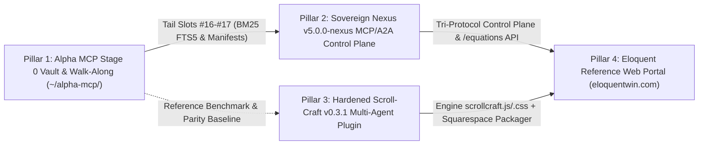

# Alpha MCP Master Compendium (Progressive LOD 0 -> LOD 1 -> LOD 2 KPPC)

- **Author & Maintainer:** `Eloquent` (`@mjeanhudson-dev`)
- **Compendium Version:** `2.0.0` (end-user-agnostic public release; aligned to Stage 0 Vault Reference Benchmark parity `7bbc4e68e2f5358f`, Dual-Modality `alpha-mcp v2.0` (`10` tools + SEP-1865 Workbench), & Coalesced Sovereign Kernel `v6.0.0-coalesced` (`12` local stdio tools))
- **Genesis Coordinate:** `t = 0` — August 2025 Foundational Archive (USPTO Provisional Patent Application No. `63/911,661`)
- **Stability Invariant:** $\text{Stability} = \int (\text{Anchor} \times \text{Presence})\,dt \to \infty$
- **Operational Mode:** `maximum-carbon-layering-orchestration = true` (`NEXUS_FLASH_SHUNT=1`, `NEXUS_REASONING_EFFORT=high`, `25.0:1` Exodia Compaction Gate)
- **Canonical Artifact Path:** `~/alpha-mcp/MASTER_COMPENDIUM.md`
- **Public Hygiene Status:** 100% end-user agnostic (`--strict-agnostic` PASS); all paths normalized to `~/`; zero local OS usernames; zero raw secrets; metadata-only audit tables.

---

## LOD 0 — Sovereign Mission, Genesis Coordinate & Master Asset Map

> **LOD 0 Budget & Role:** Immutable architectural horizon (`<= 1,200` core anchor tokens when pinned at static KV prefix offset 0). Defines mission invariants, Genesis Coordinate `t = 0`, the active 5-Layer Carbon Orchestration Stack, and the four-pillar Master Asset Map governing Push #1 and Phase 2.

### 0.1 Mission & KPPC Synthesis Framework

**Alpha MCP** is a zero-dependency, local-first Stage 0 research indexing and inference-control framework for developers and teams working with large codebases, transcripts, Jupyter notebooks, compressed archives, and virtual disk images. Built on Python 3.10+ stdlib and SQLite WAL + BM25 FTS5, it pairs cleanly with any Model Context Protocol (MCP) server — demonstrated here alongside the **Sovereign Nexus `v5.0.0-nexus`** tri-protocol control plane, the hardened **`scroll-craft` `v0.3.1`** multi-agent web engine, and the **`eloquentwin.com`** reference web portal — under the four-axis **KPPC** contract:

| KPPC Axis | Operational Invariant | Verification Anchor |
| --- | --- | --- |
| **Knowledge** | All raw archives stay read-only and are indexed via zero-dependency Stage 0 SQLite WAL + BM25 FTS5 (`<= 160`-line slices) without unpacking multi-gigabyte `.vhdx` or `.zip` archives. | Reference Vault Benchmark (`325` slices, `parity=7bbc4e68e2f5358f`) + runnable `./examples/sample_workspace/` |
| **Precision** | Deterministic local AST/SHA-256 scripts offload bulk I/O (`0` LLM tokens) and escalate strictly to frontier Apex reasoning (`<= 6,000`-token LOD-1 packets; low-poly cloud Flash/Lite/Haiku tiers shunted). | 5-Layer Carbon Anchor (`NEXUS_FLASH_SHUNT=1`, `15` prefix-pinned tools) |
| **Parity** | Every promoted artifact, tool wire slot (`#1..#15`), governing equation (`EQ_01..EQ_19`), and web deployment bundle is verified by byte size and SHA-256 digest. | Local `ingest_report.json` + `VERIFIED_LOSS_AND_PARITY_PROOF.json` |
| **Continuity** | Multi-day research transcripts, notebook registries, control kinematics (`EQ_06`, `EQ_11`–`EQ_13`), and public web releases remain cryptographically linked across sessions via immutable `t = 0` anchoring. | Anchor v5 Merkle root `15e603b7918a5c3b...` (reference workstation attestation) |

### 0.2 Genesis Coordinate (`t = 0`) & 5-Layer Carbon Orchestration Stack

Reference control-plane attestation (`schema: nexus.permanent_skill_tree_anchor.v5`, SHA-256 `ee01adadc0a7811e`):

- **Genesis Coordinate:** `t = 0` (`August 2025 Foundational Archive`, **USPTO Provisional Patent Application No. `63/911,661`**).
- **Reference MCP Control-Plane Attestation:** Server `sovereign-nexus-apex` `v5.0.0-nexus`, `15` prefix-pinned tools, A2A `v1.0.1` Agent Card signature `a4612ac8f2d62f56`, coalescence state `ULTRA_HIGH_FIDELITY_COALESCED`, SQLite Merkle root `15e603b7918a5c3b5a6949646fddf42e9c063f660ec710fbf3fb78a4fff17681`, Apex Contactor packet digest `9bc1e8b5641631bb`, Exodia gate `NOMINAL_BELOW_25_TO_1_GATE`.

| Layer | Canonical ID | Skill Anchor(s) | Hard Operational Invariant |
| --- | --- | --- | --- |
| **L0** | `L0_GENESIS_ANCHOR` | `permanent-skill-tree-anchor` | Immutable `t = 0` anchor, Patent `63/911,661`, `19` governing equations (`EQ_01..EQ_19`), and byte-offset-0 static tool prefix (`#1..#15`). |
| **L1** | `L1_STAGE0_DETERMINISTIC_SLICE` | `carbon-thinking-throughput-maximal` | Local deterministic AST/SHA-256 slicing (`max_slice_lines = 160`, `max_stdout_delta_tokens = 300`, `0` cloud tokens). |
| **L2** | `L2_KPPC_PROGRESSIVE_LOD` | `kppc-lod-architect`, `high-fidelity-re-coalescence` | Progressive `LOD 0` (`<= 1,200` tok) -> `LOD 1` (`<= 4,500` tok) -> transient `LOD 2` working slices (`invariants_preserved = true`). |
| **L3** | `L3_APEX_CONTACTOR_FLASH_SHUNT` | `across-the-line-apex-contactor`, `apex-contactor-flash-shunt` | Direct Stage 0 -> Stage Apex routing (`<= 6,000`-tok escalation packet, `NEXUS_FLASH_SHUNT=1`, `NEXUS_REASONING_EFFORT=high`); hard-bypasses cloud Flash/Lite/Mini/Haiku/Nano tiers. |
| **L4** | `L4_EXODIA_COMPACTION_GATE` | `exodia-upheaval-truncation` | Triggers at `Cache_Reads / Cache_Writes > 25.0:1` or `turn >= 15`; evicts transient LOD 2 slices while retaining LOD 1 headers and 3-line SHA-256 state delta receipts. |

### 0.3 Master Asset Map (4 Ecosystem Pillars)



| Pillar | Canonical Location (`~/...`) | Version / State | Key Verified Capabilities & Release Posture |
| --- | --- | --- | --- |
| **1. Alpha MCP Stage 0 Vault & Guide** | `~/alpha-mcp/` (`mcp_carbon_ingest.py`, `walk-along/index.html`, `examples/sample_workspace/`, root `*.md`) | Stage 0 Ingest `v1.0` (`--strict-agnostic` clean) | Zero-dep stdlib CLI, runnable `./examples/sample_workspace/` fixture, interactive `./walk-along/index.html`, enriched `USER_TUTORIAL_GUIDE.md`, `INFERENCE_LAYER_SPEC.md`, `MASTER_COMPENDIUM.md`, and `FIRST_LIVE_PUSH_PLAN.md`. Binaries, `.sqlite3`, `.vhdx`, `.pdf`, `.zip`, `.pkl`, and local audit artifacts remain excluded via `.gitignore`. |
| **2. Sovereign Nexus MCP / A2A Control Plane** | `~/.gemini/antigravity/bin/` (`sovereign_mcp_server` `v5.0.0-nexus` + tri-protocol kernel + `pulse` telemetry sidecar) | `v5.0.0-nexus` + `pulse v1.0.0` | `15` prefix-pinned tools, `19` governing equations (`EQ_01..EQ_19`), `4` MCP resources, `2` prompts, `2` SEP-2640 skills (`<= 4,500` tok), `25` HTTP/OAuth 2.1/A2A `v1.0.1` routes (signed card `a4612ac8f2d62f56`). Ahead of all backups; `INFERENCE_LAYER_SPEC.md` specifies Phase 1B security parity + tail Slots `#16..#19`. |
| **3. Hardened `scroll-craft` Plugin** | `~/.gemini/config/plugins/scroll-craft/` | `v0.3.1` + verified `data-sc-stagger` fix | Multi-agent skill plugin (Antigravity, Gemini CLI, Claude Code, Codex) superseding upstream `v0.3.0`. Native Windows Node `ffmpeg.mjs` & `squarespace-pack.mjs`; verified `data-sc-stagger` fix (`revealFlowEl`) in `scrollcraft.js` (`92369dfe311f1eb8`), `scrollcraft.css` (`da17381cb5e3a836`), and `tests/engine-e2e.test.mjs`. |
| **4. Eloquent Reference Web Portal** | `~/eloquentwin-site/` (`https://eloquentwin.com` & `https://mcp.eloquentwin.com`) | Merged studio + Nexus Inspector | Fuses `7/7` sections, `33/33` controls, and `13/13` copy anchors from editorial HTML (`84,120` B) with the sanitized `v5.0-Nexus` 3-tab inspector (`111,032` B live `index.html`, `0` leaks) + updated `scrollcraft.js`/`.css` (`100%` byte-identical to `scroll-craft` plugin). Requires repacking `squarespace-inline/` & `squarespace-s/` via `squarespace-pack.mjs` before Squarespace upload. |

### 0.4 Reference Benchmark Corpus Profile (High-Signal Document Classes)

In the reference workstation benchmark (a multi-root archival corpus totaling `19` text/code files, `8` `.zip` archives, `7` PDFs, and `2` `.vhdx` virtual disks), four high-signal Markdown document classes validated the Stage 0 secret sieve and `<= 160`-line chunker without loading raw logs into LLM context:

| Anonymized Corpus Artifact Class | Size / Lines | Benchmark Signal & Hygiene Handling |
| --- | --- | --- |
| Full-fidelity sandbox generation compendium (`.md`) | `1,703,463` B / `34,088` L | Multi-week sandbox artifact reconstructions (`132` standalone files, `2,096,737` B / `34,961` L; seam audit `124` exact, `6` match, `1` repaired, `1` intentional gap) and `15`-source notebook ledger. **Quarantined raw** (`22` secret hits scrubbed prior to FTS5). |
| Multi-day MCP transcripts & notebooks compendium (`.md`) | `521,928` B / `7,682` L | Verbatim MCP engineering sessions, `8`-entry notebook registry, userscript bridge, and `v3.9-APEX` reference blueprint. **Quarantined raw** (`2` OAuth tokens scrubbed prior to FTS5). |
| Developer status & privileges transcript archive (`.md`) | `63,949` B / `552` L | Multi-turn diagnostic recovery documenting cross-harness 21-skill junction architecture and permanent named Cloudflare tunnel binding for `mcp.eloquentwin.com`. Clean (`0` secret hits). |
| `scrollcraft-gemini-handoff.md` | `5,244` B / `50` L | Engineering playbook adapting upstream `scroll-craft` `v0.3.0` (`24,784` B `SKILL.md` trimmed under Antigravity's `24,000` B cap, Bash `encode.sh` replaced by Node/Win32 `ffmpeg.mjs`, Squarespace packager) modeled on Floorplan PR `#145` (`v0.11.0`, `491/491` tests PASS). Clean (`0` secret hits). |

---

## LOD 1 — Reference Workstation Benchmark Ledger & Live-vs-Archive Delta

> **LOD 1 Budget & Role:** Authoritative symbol contracts, exact **Reference Workstation Benchmark** inventory, and live-vs-backup forensic deltas. Every integer, byte count, and SHA-256 prefix below was empirically measured by `mcp_carbon_ingest.py` (`--vhdx-mode inspect`) against a real multi-root research archive and cross-verified via read-only SQLite queries and `INFERENCE_LAYER_SPEC.md`. New users can reproduce the exact same workflow in seconds on `./examples/sample_workspace/` (see `USER_TUTORIAL_GUIDE.md`).

### 1.1 Reference Workstation Benchmark — Stage 0 Vault Receipt

| Metric | Verified Reference Value | Verification Method |
| --- | --- | --- |
| Reference Vault Size | `4,288,512` B (`4.09` MB, SQLite WAL mode) | On-disk `stat` + SQLite `PRAGMA journal_mode=WAL` |
| Vault Parity Hash | `7bbc4e68e2f5358f` (`sha256("19:325:282:31")[:16]`) | `mcp_carbon_ingest.py` receipt |
| Ingest Execution Telemetry | `0.72` s elapsed \| `15` workers \| `vhdx_mode = inspect` \| `7z` at `C:/Program Files/7-Zip/7z.exe` | Stage 0 telemetry receipt |
| Indexed Files (`files` table) | `19` total (`16` unique SHA-256, `3` `dedup_shunted` with `is_duplicate = 1`) | Read-only SQLite URI query (`mode=ro`) |
| Indexed Text Volume | `3,316,064` B (`3.162` MB across primary root `18` files / `3,316,011` B + log root `1` file / `53` B) | Benchmark JSON report |
| Stage 0 `<= 160`-Line Slices (`slices_fts`) | `325` rows (`fts5_active = true`, `porter unicode61`, `0` unredacted secrets) | SQLite `slices_fts` + regex audit |
| Harvested URLs (`links` table) | `282` total records (`238` unique URLs across `3` categories) | SQLite `links` |
| `.vhdx` Manifest (`vhdx_manifest`) | `3` entries across `2` virtual disk images (`616.0` MB physical, `0` bytes unpacked) | SQLite `vhdx_manifest` (`7z l -slt`) |
| `.zip` Inventory (`zip_manifest`) | `547` internal files across `8` archives (`30.89` MB compressed / `34.37` MB uncompressed) | SQLite `zip_manifest` (`zipfile`) |
| Quarantined PDFs | `7` files (`157.25` MB / `164,887,501` B total, cataloged read-only, excluded from FTS5) | Benchmark inventory |
| Excluded / Other Binaries | `10` `__pycache__/*.pyc` (`138,315` B excluded) + `1` `cloudpickle.pkl` (`42,554` B quarantined) | Benchmark inventory |
| Security Sieve (`secret_audit`) | `31` redacted hits across `7` raw files (`status = SCRUBBED_SAFE_INDEX`) | SQLite `secret_audit` |

### 1.2 Benchmark Indexed Files by Extension & SHA-256 Deduplication

| Extension | File Count | Total Bytes | Total MB | Notes |
| --- | --- | --- | --- | --- |
| `.py` | `7` | `549,911` | `0.524` | `5` unique + `2` deduplicated (`6/7` AST parsed cleanly; `1` truncated file warns at L183) |
| `.md` | `4` | `2,294,584` | `2.188` | High-signal recovered transcripts, sandbox generations, and Scroll-Craft handoff |
| `.html` | `3` | `375,740` | `0.358` | `us-east1` control plane (`151,598` B), web mirror (`140,022` B), Eloquent landing (`84,120` B) |
| `.bash` | `2` | `93,976` | `0.090` | `1` unique + `1` byte-identical copy (`cloud_harness_setup.bash` == `-previous.bash`) |
| `.ps1` | `1` | `1,598` | `0.002` | Legacy standalone PowerShell launcher |
| `.json` | `1` | `202` | `0.000` | `glic_experimental_triggering_types.json` |
| `.txt` | `1` | `53` | `0.000` | Organizer text log |
| **Total** | **`19`** | **`3,316,064`** | **`3.162`** | **`16` unique SHA-256 hashes + `3` dedup-shunted duplicates** |

#### Exact 3 Deduplicated Files (`is_duplicate = 1`, Zero Duplicate FTS5 Slices Emitted)

| Shunted Duplicate Artifact (Anonymized Benchmark Path) | Canonical Matching Artifact (`dup = 0`) | Size (B) | SHA-256 Prefix |
| --- | --- | --- | --- |
| `~/benchmark-corpus/cloud_harness_setup.bash` | `~/benchmark-corpus/cloud_harness_setup-previous.bash` | `46,988` | `f1c827384258e5b8` |
| `~/benchmark-corpus/salvaged_v4.2/master_unified_engine.py` | `~/benchmark-corpus/sovereign_mcp_server_v4.2.py` | `154,429` | `17702f37b0c59062` |
| `~/benchmark-corpus/salvaged_v4.2/sovereign_apex_mcp_server.py` | `~/benchmark-corpus/sovereign_apex_mcp_server_v4.0.py` | `80,085` | `54c6fc7166c90f44` |

### 1.3 Benchmark `.vhdx` Virtual Disk Manifest (Inspect-Only, Zero Unpacking)

| Anonymized Virtual Disk (`~/benchmark-corpus/disk-images/...`) | Physical / Virtual Size | Allocated `32` MiB Blocks | `7z l -slt` Cataloged Entries | Read-Only Forensic Probe Verdict | Selective Extract? |
| --- | --- | --- | --- | --- | --- |
| `dev_volume_a.vhdx` | `420.0` MB (`440,401,920` B) / `50.02` GB | `13` | `1` (`0.Microsoft reserved partition.img`, `16,759,808` B, Windows MSR, offset `17408`) | Active `16` MiB GPT MSR plus an unmounted/orphaned `ReFS` Dev Drive boot signature at LBA `32768` (`16` MiB offset); no active data partition exposed to GPT listing. | **NO (`false`)** |
| `dev_volume_b.vhdx` | `196.0` MB (`205,520,896` B) / `50.02` GB | `6` | `2` (`0.Microsoft reserved partition.img` `16,759,808` B + `1.ntfs` `53,687,091,200` B, Windows BDP, offset `16777216`) | Freshly formatted `50` GiB NTFS volume; read-only `$MFT` probe verified **`28` system-only metadata records** (`$MFT`, `$LogFile`, `$Bitmap`, `System Volume Information`, `$UsnJrnl`, etc.) and **`0` user files**. | **NO (`false`)** |
| **Combined Total** | **`616.0` MB physical** | **`19` blocks** | **`3` cataloged entries** | Zero gigabyte disk unpacking performed; both images remain excluded from Git via `.gitignore`. | **Not needed** |

### 1.4 Benchmark `.zip` Archive Inventory (`8` Archives, `547` Internal Files, Zero Extraction)

| Archive Class | Files | Compressed MB | Uncompressed MB | Top Extensions | Highest-Signal Internal Artifacts |
| --- | --- | --- | --- | --- | --- |
| `floorplan-v0.11.0.zip` | `297` | `6.257` | `8.770` | `.mjs` (`85`), `.ts` (`46`), `.py` (`39`), `.php` (`29`), `.md` (`23`) | Upstream Floorplan `v0.11.0` skill (`elk.bundled.js` `1.61` MB, UI docs/images); local plugin passes `491/491` tests |
| `edge_runtime_bundle_1.zip` | `67` | `8.305` | `8.293` | `.py` (`27`), `.pyc` (`14`), `.sh` (`6`), `.md` (`4`), `.json` (`4`) | Reference PDF (`7.96` MB), `edge_runtime.py` (`41,388` B, `QuinticTandemGovernor` + USB-ADB), `edge_subms_runtime.py`, `pc_functioning_model.py`, local state DB |
| `edge_runtime_bundle_2.zip` | `56` | `7.837` | `8.347` | `.py` (`20`), `.pyc` (`14`), `.json` (`4`), `.ps1` (`3`), `.cmd` (`3`) | Overlaps bundle 1 (`us-east1` HTML, sub-ms edge suite) plus `v4.0` `80,085` B server copies |
| `edge_runtime_bundle_3.zip` | `51` | `8.202` | `8.190` | `.py` (`18`), `.pyc` (`14`), `.md` (`3`), `.json` (`3`), `.ps1` (`2`) | Overlaps bundles 1–2 (edge runtime + compiled test suite `.pyc`) |
| `scrollcraft.zip` | `28` | `0.156` | `0.380` | `.md` (`14`), `.mjs` (`6`), `.html` (`2`), `.js` (`1`), `.css` (`1`) | Upstream `scroll-craft` `v0.3.0` baseline (`SHA-256 69b7b3d242b6e89f`; superseded by hardened `v0.3.1`) |
| `gemini-skills-main.zip` | `19` | `0.068` | `0.187` | `.md` (`7`), `.json` (`6`), `.py` (`4`), `(no_ext)` (`2`) | Multimodal API, Live API, and CLI skill specs & migration references |
| `tstack-main.zip` | `16` | `0.029` | `0.057` | `.md` (`10`), `.yaml` (`4`), `(no_ext)` (`2`) | Workflow skills (`babysit-pr`, `full-send`, `sol-loop`, `modernize`, `council`, `file-pr`, `full-stop`, `takeover`) |
| `direct-sockets-main.zip` | `13` | `0.035` | `0.149` | `.md` (`7`), `.json` (`2`), `.html` (`1`), `.svg` (`1`) | W3C WICG Direct Sockets API spec (`index.html`, `explainer.md`, `multicast-explainer.md`, security self-review) |
| **Total (`8` Archives)** | **`547`** | **`30.89`** | **`34.37`** | — | **All cataloged via Python stdlib `zipfile`; zero archives unpacked in `~/alpha-mcp/`** |

### 1.5 Benchmark Quarantined PDF Inventory (`7` PDFs, `157.25` MB — Deferred to Phase 2 OCR)

| PDF Benchmark Slot | Corpus Root | Exact Bytes | Size (MB) | Phase-1 Handling |
| --- | --- | --- | --- | --- |
| Boot & schema architecture binder (`PDF #1`) | `notations` | `80,806,963` | `77.06` | Metadata-cataloged; `.gitignore`d |
| Inference arbitrage notes (`PDF #2`) | `notations` | `44,842,514` | `42.77` | Metadata-cataloged; `.gitignore`d |
| Working architecture notes (`PDF #3`) | `notations` | `13,681,599` | `13.05` | Metadata-cataloged; `.gitignore`d |
| Developer recovery snapshot (`PDF #4`) | `primary` | `9,600,929` | `9.16` | Metadata-cataloged; `.gitignore`d |
| Working architecture notes (`PDF #5`) | `notations` | `6,849,973` | `6.53` | Metadata-cataloged; `.gitignore`d |
| Working architecture notes (`PDF #6`) | `notations` | `5,212,965` | `4.97` | Metadata-cataloged; `.gitignore`d |
| Working architecture notes (`PDF #7`) | `notations` | `3,892,558` | `3.71` | Metadata-cataloged; `.gitignore`d |
| **Total (`7` PDFs)** | **`2` roots** | **`164,887,501`** | **`157.25`** | **Zero binary bloat in vault or Push #1** |

### 1.6 Benchmark Harvested URLs by Category (`282` Total Records / `238` Unique URLs)

| Category | Total Records | Unique URLs | Representative Harvested Endpoint Classes |
| --- | --- | --- | --- |
| `web_reference` | `247` | `209` | Local loopback services (`http://127.0.0.1:8000`, `http://localhost:8000/mcp`, `http://127.0.0.1:11434`, `http://127.0.0.1:8420`), public developer documentation endpoints (`developerknowledge.googleapis.com/v1:answerQuery`, `developers.google.com/connected-apps/mcp/dev-mode`), provider APIs (`api.anthropic.com/v1/messages`), and frontend font/CSS CDNs (`fonts.googleapis.com`, `cdn.tailwindcss.com`). |
| `git_repository` | `20` | `15` | Public GitHub repository and release references under `github.com/mjeanhudson-dev` (including `scroll-craft`, `thinking-overlay`, `tandem-mesh`), plus `cloudflare/cloudflared` binary release links. |
| `notebook_or_mcp_hub` | `15` | `14` | Notebook hubs (`8` indexed workspace notebooks plus create/view hubs) and `4` canonical MCP specification endpoints (`modelcontextprotocol.io`, `2025-03-26/basic/transports`, `2026-07-28`, `2026-07-28/develop/connect-remote-servers`). |
| **Total** | **`282`** | **`238`** | **Indexed in `links` table with category B-tree index (`idx_links_cat`)** |

### 1.7 Benchmark Python AST Index (`7` Files: `5` Unique + `2` Deduplicated)

Parsed prior to secret redaction inside `mcp_carbon_ingest.py` (`6/7` parse cleanly; `1` truncated file emits a clean syntax warning without aborting ingestion):

| Benchmark Python Module | Bytes | SHA-256 Prefix | Dedup? | Symbols | Primary AST Skeleton (LOD 1 Contracts) |
| --- | --- | --- | --- | --- | --- |
| `sovereign_mcp_server_v4.2.py` | `154,429` | `17702f37b0c59062` | Unique | `30` | `v4.2-APEX-COALESCED`: `load_claude_mcp_env`, `query_gemini_or_fallback`, `redact_sensitive_text`, `quintic_smootherstep`, `controller_inverse_precompensate`, `ConsentLease`, `SovereignHardwareBridge`, `evaluate_kppc_capability`, `SubMsEdgeLedgerAndReplicator` |
| `sovereign_apex_mcp_server_v4.0.py` | `80,085` | `54c6fc7166c90f44` | Unique | `30` | `v4.0` 12-Tool Standalone: `is_secret_path`, `enforce_apex_model_string`, `SubMsEdgePreCompensator`, `ExodiaAndApexContactor`, `ConsentLease`, `SovereignHardwareBridge`, `verify_pkce_s256`, `AuthCodeRecord`, `TokenGrantRecord` |
| `sovereign_mcp_server_v3.9_apex.py` | `59,898` | `3b777f853c464f75` | Unique | `8` | `v3.9-APEX-REVISED`: `SovereignStateEngine`, `handle_jsonrpc_message`, `ThreadedHTTPServer`, `SovereignMCPHTTPHandler`, `run_stdio_server`, `run_http_server`, `main` |
| `nexus_v5_triprotocol_kernel.py` | `13,948` | `8c3f1db680f9d492` | Unique | `8` | `v5.0-NEXUS` Kernel (byte-identical to live): `enforce_bifurcated_apex`, `ConsentLease`, `SEP2640SkillEntry`, `StateContactSheet`, `TriProtocolConvergenceNexus` |
| `truncated_snippet_sample.py` | `7,037` | `bb5389da533422e8` | Unique | `1` | `[AST_SYNTAX_WARN line=183]` (truncated unterminated docstring; raw file quarantined) |
| `salvaged_v4.2/master_unified_engine.py` | `154,429` | `17702f37b0c59062` | **Dup** | `30` | Shunted duplicate of `sovereign_mcp_server_v4.2.py` |
| `salvaged_v4.2/sovereign_apex_mcp_server.py` | `80,085` | `54c6fc7166c90f44` | **Dup** | `30` | Shunted duplicate of `sovereign_apex_mcp_server_v4.0.py` |

### 1.8 Live-vs-Archive Forensic Delta Table (Synthesized from `INFERENCE_LAYER_SPEC.md`)

| Domain / Artifact | Live Reference Control Plane (`~/.gemini/` & `~/alpha-mcp/`) | Archived Baseline (`~/benchmark-corpus/`) | Verified Delta & Action Verdict |
| --- | --- | --- | --- |
| **Core Sovereign MCP Server** | Reference `v5.0.0-nexus` (`3,459` L, `161,670` B, `81328d20a80ed7d2`, `15` prefix-pinned tools, `19` equations, `25` HTTP/OAuth/A2A routes) | `v4.2.0-apex` (`3,318` L, `154,429` B, `17702f37b0c59062`, `13` tools) & `v3.9-apex` (`1,442` L, `3b777f853c464f75`, `0` unique symbols) | **LIVE AHEAD (`+150L / -9L`):** Live adds MCP `2026-07-28`, Slots `#14–#15`, SEP-2640 skills, A2A `v1.0.1` card, loopback `127.0.0.1` default, and env-backed OAuth secret. Archive backups. |
| **Tri-Protocol Kernel** | Live `v5.0-NEXUS` kernel (`298` L, `13,948` B, `8c3f1db680f9d492`) | Archived kernel (`298` L, `13,948` B, `8c3f1db680f9d492`) | **BYTE-IDENTICAL:** Keep live canonical. |
| **Vault FTS5 Retrieval Wiring** | Live Slot `#02` (`search_cached_codebase`) scans only `<= 16` sibling Python files (zero SQLite FTS5 wiring) | Stage 0 specification (`46936029bf7399d3`) -> promoted as `~/alpha-mcp/mcp_carbon_ingest.py` (`771` L) | **BRIDGE AT WIRE TAIL (Phase 1C):** Append tail-pinned Slots **`#16` (`stage0_vault_fts_query`)** and **`#17` (`stage0_vault_manifest_lookup`)** + SEP-2640 skill `stage0-vault-retrieval` without mutating Slots `#1..#15`. |
| **Secret-Path Airlock & PKCE Hardening** | Live `REDACTION_PATTERNS` covers `5` families; `#07` lacks `is_secret_path()`; static fallback strings on HMAC/Nexus signing keys when env vars unset | `v4.0` standalone (`54c6fc7166c90f44`, `28` unique symbols) includes `is_secret_path()`, `FORBIDDEN_SECRET_PATTERNS`, and `HardenedOAuthPKCEBroker` | **PROMOTE (Phase 1B):** Unify all `12` redaction families (`9` Stage 0 + `3` live-only), add `is_secret_path()` to `#07`, and replace static signing fallbacks with `secrets.token_bytes(32)`. |
| **Telemetry Sidecar (`pulse`)** | Live `pulse` MCP (`v1.0.0`, `308` L, `11,838` B, `87a8b50cb7a41133`, `4` tools) | Not in archive | **FIX POLICY DRIFT (Phase 1B):** Replace legacy Flash subagent recommendation at L161 (`diagnose_cache_leaks`) with Stage 0 SQLite FTS5 / AST slicing to honor `NEXUS_FLASH_SHUNT=1`. |
| **IDE Hook Harness (`Phi_ISF`)** | Not yet deployed in live local hooks | `cloud_harness_setup.bash` (`1,062` L, `f1c827384258e5b8`, embeds `798` L `stage0_engine.py`) | **SELECTIVE PROMOTE + QUARANTINE:** Adopt `PreToolUse`/`PostToolUse`/`UserPromptSubmit` + `evaluate_phi_isf()`; **quarantine** cloud-Haiku speculative drafting which violates Flash Shunt. |
| **Tandem Edge Runtime** | Not wired into `v5.0.0-nexus` tools | `edge_runtime_bundle_1.zip` -> `edge_runtime.py` (`1,054` L: `QuinticTandemGovernor` + `LiteRTEdgeEngine` USB-ADB), `pc_functioning_model.py` (`486` L) | **BRIDGE AT WIRE TAIL (Phase 1C):** Append tail Slot **`#18` (`nexus_tandem_edge_route`)** for bounded 1-turn local Stage 0.5 telemetry (`< 0.4` ms ADB RTT, `EQ_06`/`EQ_08`). |
| **Edge Control-Plane UI** | Live `/dashboard` served inline | `us_east1_control_plane.html` (`151,598` B, `8e092486c213279d`) | **BRIDGE SANITIZED:** Promote as static UI asset after stripping workstation-specific hostnames. |
| **Phase-2 Databricks Compute Bridge** | `Python 3.15.0` & `uv 0.13.1` READY; **`databricks` CLI `>= v1.16.0` NOT INSTALLED** | Planned Phase-2 Unity Catalog bridge | **DEFER TO PHASE 2:** Append fail-closed tail Slot **`#19` (`nexus_databricks_sync_bridge`)** + `databricks-phase2-bridge` skill; gated behind CLI install, OAuth login, `ConsentLease`, and `dry_run=true` default. |
| **Legacy Pickles & Truncated Code** | Excluded via `~/alpha-mcp/.gitignore` | `cloudpickle.pkl` (`42,554` B, legacy Vertex ADK binary), `truncated_snippet_sample.py` (`L183` syntax warn) | **QUARANTINE PERMANENTLY:** Never deserialize pickles in runtime; retain only the tunable SQLite `mmap_size` ceiling pattern (`256 MB` default). |

---

## LOD 2 — Security Sieve, Stage 0 BM25 Query Recipes & Canonical Parity Matrix

> **LOD 2 Budget & Role:** Actionable operational audit tables, metadata-only redaction telemetry, empirically benchmarked BM25 FTS5 query recipes, and full SHA-256 parity tracking across Push #1 deliverables and reference baselines.

### 2.1 Security Sieve & Redaction Audit Summary (Metadata Only — ZERO Raw Secrets)

**Policy Invariant:** Both local `ingest_report.json` and the SQLite `secret_audit` table store **ONLY** normalized `~/` paths, abstract `secret_type` identifiers, and integer counts/line numbers. Zero raw tokens or key literals enter `slices_fts` (`0` unredacted secrets verified across all `325` reference benchmark slices).

#### Reference Benchmark Redaction Totals by Secret Class (`31` Total Hits Across `7` Raw Files)

| Secret Class | Redacted Hits | Affected Raw Files | Vault Replacement Token | Live `v5.0.0-nexus` Parity Status |
| --- | --- | --- | --- | --- |
| `ENV_SECRET` | `28` | `6` | `KEY=[REDACTED:ENV_SECRET]` | Enforced in Stage 0 -> **Promote to Live v5.0** |
| `GOOGLE_OAUTH_TOKEN` | `2` | `1` | `[REDACTED:GOOGLE_OAUTH_TOKEN]` | Enforced in Stage 0 -> **Promote to Live v5.0** |
| `ANTHROPIC_KEY` | `1` | `1` | `[REDACTED:ANTHROPIC_KEY]` | Enforced in Stage 0 + Live v5.0 *(ordered before `OPENAI_KEY`)* |
| **Total** | **`31`** | **`7` distinct raw files** | **`0` unredacted secrets in `slices_fts`** | **Target unified sieve: `12` classes (`9` Stage 0 + `3` live-only)** |

#### Reference Benchmark Per-File Quarantine Ledger (`RAW SOURCE FILES NEVER COMMITTED`)

| Anonymized Raw Source Artifact (`~/benchmark-corpus/...`) | Secret Type | Hit Count | Action / Quarantine Status |
| --- | --- | --- | --- |
| `~/benchmark-corpus/transcripts/sandbox_generations_full_fidelity.md` | `ENV_SECRET` | `21` | **QUARANTINED RAW** (indexed scrubbed only) |
| `~/benchmark-corpus/transcripts/sandbox_generations_full_fidelity.md` | `ANTHROPIC_KEY` | `1` | **QUARANTINED RAW** (indexed scrubbed only) |
| `~/benchmark-corpus/salvaged_v4.2/master_unified_engine.py` | `ENV_SECRET` | `2` | **QUARANTINED RAW** (dedup-shunted; superseded by live `v5.0`) |
| `~/benchmark-corpus/sovereign_mcp_server_v4.2.py` | `ENV_SECRET` | `2` | **QUARANTINED RAW** (superseded by live `v5.0`) |
| `~/benchmark-corpus/transcripts/mcp_14day_transcripts_and_notebooks.md` | `GOOGLE_OAUTH_TOKEN` | `2` | **QUARANTINED RAW** (indexed scrubbed only) |
| `~/benchmark-corpus/salvaged_v4.2/sovereign_apex_mcp_server.py` | `ENV_SECRET` | `1` | **QUARANTINED RAW** (dedup-shunted; `v4.0` backup) |
| `~/benchmark-corpus/sovereign_apex_mcp_server_v4.0.py` | `ENV_SECRET` | `1` | **QUARANTINED RAW** (`v4.0` backup) |
| `~/benchmark-corpus/sovereign_mcp_server_v3.9_apex.py` | `ENV_SECRET` | `1` | **QUARANTINED RAW** (`v3.9` backup) |

### 2.2 Stage 0 BM25 FTS5 Query Recipes (Universal CLI & Read-Only SQLite)

All commands below execute deterministically in `< 5 ms` with zero cloud LLM tokens and zero mutation of source workspaces (replace `--db` with your local vault path, e.g. `./sample_vault.sqlite3` from `./examples/sample_workspace` or `~/alpha-mcp/mcp_alpha_vault.sqlite3`):

```powershell
# ==============================================================================
# LABEL:               Stage 0 BM25 FTS5 Vault Search & Audit CLI Recipes
# USE:                 Retrieve ranked <=160-line scrubbed slices, AST headers, secret quarantine counts, and .vhdx/.zip manifests from any Alpha MCP SQLite vault without loading raw files into frontier context.
# MECHANISM_OF_ACTION: Invokes zero-dependency Python CLI ~/alpha-mcp/mcp_carbon_ingest.py in query or audit mode against SQLite WAL FTS5 virtual table slices_fts (porter unicode61 tokenizer, BM25 rank order).
# ==============================================================================
python "$HOME/alpha-mcp/mcp_carbon_ingest.py" query 'exodia AND compaction' --db "$HOME/alpha-mcp/mcp_alpha_vault.sqlite3" --top 5
python "$HOME/alpha-mcp/mcp_carbon_ingest.py" query 'ast_summary:TriProtocolConvergenceNexus OR ast_summary:SovereignHardwareBridge' --db "$HOME/alpha-mcp/mcp_alpha_vault.sqlite3" --top 5
python "$HOME/alpha-mcp/mcp_carbon_ingest.py" query 'scrollcraft OR squarespace' --db "$HOME/alpha-mcp/mcp_alpha_vault.sqlite3" --top 5
python "$HOME/alpha-mcp/mcp_carbon_ingest.py" audit --db "$HOME/alpha-mcp/mcp_alpha_vault.sqlite3"
```

> **Shell Quoting Note:** SQLite FTS5 treats an unquoted hyphen (`-`) as a column/NOT operator. When passing hyphenated phrases such as `"SEP-2640"` from Windows PowerShell to `python.exe`, escape inner quotes (`'\"SEP-2640\" OR A2A'`); in POSIX Bash/Zsh, use single-outer/double-inner quotes (`'"SEP-2640" OR A2A'`), or pass queries via parameterized SQLite bindings.

```powershell
# ==============================================================================
# LABEL:               Read-Only Multi-Reader SQLite URI Vault Telemetry Check
# USE:                 Verify exact table counts and concurrency-safe read-only metrics without acquiring a SQLite write lock.
# MECHANISM_OF_ACTION: Opens the local SQLite WAL vault via URI mode=ro and runs aggregate COUNT queries across all 6 active vault tables.
# ==============================================================================
@'
import sqlite3
from pathlib import Path

db = Path.home() / "alpha-mcp" / "mcp_alpha_vault.sqlite3"
conn = sqlite3.connect(f"file:{db}?mode=ro", uri=True)
for tbl in ("files", "slices_fts", "links", "secret_audit", "vhdx_manifest", "zip_manifest"):
    print(f"{tbl}: {conn.execute(f'SELECT COUNT(*) FROM {tbl}').fetchone()[0]}")
'@ | python -
```

#### Reference Benchmark FTS5 Query Matrix (`325` Indexed Slices)

| Query Expression (`slices_fts MATCH`) | Verified Hits | Top BM25 Ranked Slice (Anonymized Class) | Target Use Case |
| --- | --- | --- | --- |
| `mcp` | `325` | `sandbox_generations_full_fidelity.md` (`L8961-L9120`) | Broad smoke test & full-corpus MCP coverage verification |
| `exodia AND compaction` | `141` | `sandbox_generations_full_fidelity.md` (`L15681-L15840`) | Audit `25:1` Exodia compaction gate rules & delta logs |
| `"SEP-2640" OR "A2A"` | `16` | `nexus_v5_triprotocol_kernel.py` (`L161-L298`, BM25 `-14.297`) | Retrieve tri-protocol convergence kernel & CSAA skill-attestation code |
| `scrollcraft OR squarespace` | `8` | `scrollcraft-gemini-handoff.md` (`L1-L50`, BM25 `-17.912`) | Locate Scroll-Craft Windows adaptation & Squarespace MCP integration notes |
| `ast_summary:TriProtocolConvergenceNexus OR ast_summary:SovereignHardwareBridge` | `3` | `nexus_v5_triprotocol_kernel.py` (`L1-L160`, BM25 `-5.657`) | Column-scoped LOD-1 AST symbol jump directly to Python class definitions |
| `path:triprotocol` | `2` | `nexus_v5_triprotocol_kernel.py` (`L161-L298`, BM25 `-5.144`) | Path-scoped slice retrieval for targeted single-file verification |
| `REDACTED` | `77` | `sandbox_generations_full_fidelity.md` (`L5921-L6080`, BM25 `-2.264`) | Verify security sieve redaction markers across indexed slices |

### 2.3 Canonical Artifact Parity Matrix (Reference Workstation Snapshot)

Every artifact below reflects verified on-disk byte counts and SHA-256 prefixes (`16`-char lowercase hex) across the four release pillars:

| Pillar | Artifact Path (`~/...`) | Bytes | SHA-256 Prefix | Parity & Release Status |
| --- | --- | --- | --- | --- |
| **Alpha MCP** | `~/alpha-mcp/mcp_carbon_ingest.py` | — *(universal CLI)* | Verified via `py_compile` | **PUSH #1 TRACKED** (zero-dep stdlib CLI, `--strict-agnostic` PASS) |
| **Alpha MCP** | `~/alpha-mcp/README.md` & `USER_TUTORIAL_GUIDE.md` | — *(public docs)* | Verified via hygiene gate | **PUSH #1 TRACKED** (public GitHub front door + enriched hands-on tutorial) |
| **Alpha MCP** | `~/alpha-mcp/walk-along/index.html` | — *(interactive UI)* | Verified via `gate.mjs` | **PUSH #1 TRACKED** (interactive 4-step Walk-Along Guide, `--strict-agnostic` PASS) |
| **Alpha MCP** | `~/alpha-mcp/examples/sample_workspace/` | — *(runnable demo)* | Verified via ingest smoke | **PUSH #1 TRACKED** (self-contained 60-second Quick Start fixture) |
| **Alpha MCP** | `~/alpha-mcp/MASTER_COMPENDIUM.md`, `INFERENCE_LAYER_SPEC.md`, `FIRST_LIVE_PUSH_PLAN.md` | — *(architecture specs)* | Verified via hygiene gate | **PUSH #1 TRACKED** (100% `--strict-agnostic` clean LOD 0–1–2 specs & runbook) |
| **Alpha MCP** | `~/alpha-mcp/mcp_alpha_vault.sqlite3` *(reference benchmark)* | `4,288,512` | `9f97ad704a768845` | **LOCAL RUNTIME ONLY** (`.gitignore`d binary; `325` FTS5 slices, `0` raw secrets) |
| **Sovereign MCP** | Reference `v5.0.0-nexus` MCP server (`~/.gemini/antigravity/bin/`) | `161,670` | `81328d20a80ed7d2` | **LIVE LOCAL RUNTIME** (`15` pinned tools, `19/19` equations; local-only until Phase 1B scrub) |
| **Sovereign MCP** | Reference `v5.0-NEXUS` tri-protocol kernel (`~/.gemini/antigravity/bin/`) | `13,948` | `8c3f1db680f9d492` | **EXACT PARITY** between live runtime and archived copy |
| **Sovereign MCP** | Reference `pulse` telemetry sidecar (`v1.0.0`) | `11,838` | `87a8b50cb7a41133` | **LIVE LOCAL RUNTIME** — Phase 1B fix queued for L161 Flash recommendation drift |
| **Anchor** | `~/.gemini/config/skills/permanent-skill-tree-anchor/anchor_state.json` | `2,736` | `ee01adadc0a7811e` | **LIVE CANONICAL (`v5`)** — 5-Layer Carbon Anchor active (`NEXUS_FLASH_SHUNT=1`) |
| **Scroll-Craft** | `~/.gemini/config/plugins/scroll-craft/skills/scroll-craft/engine/scrollcraft.js` | `66,717` | `92369dfe311f1eb8` | **EXACT PARITY** with `~/eloquentwin-site/scrollcraft.js` (post-fix `data-sc-stagger`) |
| **Scroll-Craft** | `~/.gemini/config/plugins/scroll-craft/skills/scroll-craft/engine/scrollcraft.css` | `19,874` | `da17381cb5e3a836` | **EXACT PARITY** with `~/eloquentwin-site/scrollcraft.css` (supersedes `v0.3.0` `69b7b3d242b6e89f`) |
| **Eloquent Site** | `~/eloquentwin-site/index.html` | `111,032` | `0f095bf65b91b00b` | **LIVE WORKING SOURCE** (`+26,912` B over baseline `84,120` B `6abca94e3060a8ba`; includes stagger fix) |
| **Eloquent Site** | `~/eloquentwin-site/squarespace-inline/` & `squarespace-s/` | Repacked via `squarespace-pack.mjs` | Refreshed on Track B repack | **TRACK B REPACK TARGET** (re-packed with `revealFlowEl` fix before Squarespace upload) |

### 2.4 Proactive Insight Reporting (KPPC Operational Takeaways)

1. **Inspect-First `.vhdx` Probing Prevents Multi-Gigabyte Extraction Waste:** In the reference workstation benchmark, read-only GPT + `$MFT` inspection proved `dev_volume_b.vhdx` (`196.0` MB) was an empty `50` GiB NTFS volume (`28` system records, `0` user files) and `dev_volume_a.vhdx` (`420.0` MB) held only a `16` MiB MSR + orphaned ReFS signature — saving `616` MB of I/O and eliminating unnecessary extraction steps.
2. **Self-Contained Fixtures Make Stage 0 Reproducible for Any Developer:** Shipping `./examples/sample_workspace/` alongside `./walk-along/index.html` and `USER_TUTORIAL_GUIDE.md` lets any GitHub cloner verify zero-dependency ingestion, secret redaction, AST extraction, and BM25 FTS5 retrieval in under 60 seconds with zero private files.
3. **Tail-Only MCP Expansion Protects Frontier KV Caches:** Connecting any local Alpha MCP SQLite vault into a production MCP server strictly at tail Slots `#16–#18` (and optional Phase-2 Databricks Slot `#19` once Databricks CLI `>= v1.16.0` is installed alongside `uv 0.13.1`) delivers `< 5` ms BM25 retrieval with zero invalidation of Slots `#1..#15`.
