<p align="left">
  
</p>

# Alpha MCP v2.0 — Sovereign Dual-Modality MCP & Stage 0 Carbon Research Vault

**Author:** `Eloquent` (`@mjeanhudson-dev`) · **Version:** `2.0.0` · **Runtime:** Python `3.10+` stdlib only (`0` pip dependencies) · **Transports:** Local `stdio` + Authenticated `Streamable HTTP` · **Storage:** SQLite WAL + BM25 FTS5 · **Plugin:** Native `/alpha-mcp` skill (`plugin.json` + `.claude-plugin/plugin.json`)

**Alpha MCP v2.0** is a zero-dependency, local-first Stage 0 indexing CLI and **Sovereign Dual-Modality Model Context Protocol (MCP)** server for developers and AI engineering teams. It turns sprawling folders of source code, Markdown specs, Jupyter notebooks, Chrome `.url` bookmarks, `.zip` archives, and `.vhdx` virtual disks into a sub-5ms, secret-scrubbed **SQLite WAL + BM25 FTS5** vault—and exposes **10 prefix-pinned read-only tools**, signed **Google A2A `v1.0.1`** discovery, **SEP-2640** atomic skills, and **OAuth 2.1 `S256` PKCE** over both local `stdio` and `$0.00/mo` online `Streamable HTTP`.

- **Live Interactive Walk-Along (GitHub Pages):** [https://mjeanhudson-dev.github.io/alpha-mcp/walk-along/](https://mjeanhudson-dev.github.io/alpha-mcp/walk-along/) (or open local [`./walk-along/index.html`](./walk-along/index.html)) — 4-step interactive simulator covering inspect -> scrub/slice -> BM25 query -> MCP bridge.
- **Zero-Cost Online Architecture Blueprint:** Read [`./deploy/ZERO_COST_ONLINE_ARCHITECTURE.md`](./deploy/ZERO_COST_ONLINE_ARCHITECTURE.md) for the complete `$0.00/mo` guide (Local `stdio`, Cloudflare Named Tunnel, Google Cloud Run `min-instances=0`, Static Edge Web Hosting, and hidden billing guardrails).
- **Hands-On Tutorial & Cookbook:** Read [`./USER_TUTORIAL_GUIDE.md`](./USER_TUTORIAL_GUIDE.md) for the 60-second quick start, Stage 0 best practices, PowerShell/Bash FTS5 escaping rules, and production extensions.

---

## 60-Second Quick Start

Run Alpha MCP out of the box against the bundled, self-contained [`./examples/sample_workspace/`](./examples/sample_workspace/) fixture (zero `pip install` required):

```bash
# ==============================================================================
# LABEL:               Alpha MCP 60-Second Sample Vault Quick Start
# USE:                 Verify zero-dependency Stage 0 ingestion, SHA-256 deduplication, secret redaction, AST extraction, and BM25 FTS5 search on ./examples/sample_workspace.
# MECHANISM_OF_ACTION: Invokes mcp_carbon_ingest.py (Python 3.10+ stdlib) to build a temporary SQLite WAL + FTS5 database, inspect redaction/link audit summaries, and run ranked BM25 searches.
# ==============================================================================
python ./mcp_carbon_ingest.py ingest --roots ./examples/sample_workspace --db ./sample_vault.sqlite3
python ./mcp_carbon_ingest.py audit --db ./sample_vault.sqlite3
python ./mcp_carbon_ingest.py query 'mcp' --db ./sample_vault.sqlite3 --top 5
python ./mcp_carbon_ingest.py query 'ast_summary:LocalResearchMCPServer' --db ./sample_vault.sqlite3 --top 5
```

Expected deterministic receipt (matches [`./examples/sample_ingest_report.json`](./examples/sample_ingest_report.json)):

```text
[CARBON_STAGE_0_RECEIPT] vault=sample_vault.sqlite3 parity=5ee0d39b62b63f02 elapsed=0.31s ...
[METRICS] files=6 dedup_shunted=1 slices_160L=4 links=9 vhdx_entries=0 zip_entries=0
[SECURITY_SIEVE] secrets_redacted=2 fts5_active=True status=SCRUBBED_SAFE_INDEX
```

---

## Architecture at a Glance

```mermaid
flowchart LR
    SRC["Source Folders (code, .md, .ipynb, .url, .zip, .vhdx)"]
    ING["Stage 0 CLI (mcp_carbon_ingest.py: mmap SHA-256, AST, 9-Class Secret Sieve)"]
    DB[("SQLite WAL + BM25 FTS5 Vault (<=160L scrubbed slices)")]
    MCP["Dual-Modality MCP v2.0 (stdio + Streamable HTTP, 10 Prefix-Pinned Tools, OAuth 2.1 S256 PKCE, A2A v1.0.1)"]
    EDGE["$0.00/mo Edge (Cloudflare Named Tunnel / Cloud Run min-instances=0)"]
    APEX["Frontier Reasoning (<=6k tok LOD-1 packets, 25:1 Compaction Gate)"]

    SRC -->|"Read-only inspect"| ING
    ING -->|"0 raw secrets"| DB
    DB -->|"mode=ro (<5ms BM25)"| MCP
    MCP -->|"Local stdio (<3ms) or HTTPS"| EDGE
    EDGE -->|"Bounded snippets & signed CSAA artifacts"| APEX
```



### Core Capabilities

- **Zero-Copy `mmap` SHA-256 Deduplication:** Streams `4 MiB` windows to detect byte-identical files across multiple roots and shunts duplicates (`is_duplicate = 1`) before FTS5 chunking.
- **Pre-Index Secret Sieve & Runtime Output Airlock:** Scrubs `9` credential classes prior to indexing (`secret_audit` logs metadata only) and applies a `13`-pattern redaction sieve plus `SECRET_PATH_AIRLOCK_DENY` across every MCP tool response.
- **Deterministic `<= 160`-Line AST Slicing:** Parses Python AST skeletons *before* redaction so `ast_summary` stays syntactically accurate, strips bloated base64 outputs from Jupyter `.ipynb` cells natively, and slices text into bounded `<= 160`-line chunks.
- **Zero-Extraction Archive & Disk Inspection:** Lists internal entries of `.zip` archives via stdlib `zipfile` (`zip_manifest`) and `.vhdx` virtual disks via optional `7-Zip` `7z l -slt` (`vhdx_manifest`) without unpacking gigabytes onto disk.
- **Sovereign Dual-Modality MCP v2.0:** Runs either local `stdio` (`--transport stdio`) or hardened `Streamable HTTP` (`--transport http --require-auth`) with **OAuth 2.1 `S256` PKCE**, signed **Google A2A `v1.0.1`** (`/.well-known/agent-card.json`), **SEP-2640** atomic skills (`<= 4,500` tokens), nil-arg resilient prompts, `resources/read`, and `capabilities.tools.listChanged = false` to preserve frontier KV prompt-cache prefix hits.

---

## Sovereign Dual-Modality MCP v2.0 (`alpha_mcp_server.py`)

### 10 Prefix-Pinned Tools (`capabilities.tools.listChanged = false`)

Tool slots `#01` through `#10` are strictly pinned in deterministic wire order to guarantee prompt-cache prefix stability:

| Slot | Tool Name | Purpose & Invariants |
| --- | --- | --- |
| `#01` | `stage0_vault_fts_query` | Sub-5ms BM25 FTS5 search over redacted `<=160`-line vault slices (`query`, `top_k`, `db_path`) |
| `#02` | `stage0_vault_manifest_lookup` | Metadata-only vault counts plus `vhdx`, `zip`, `links`, and `secret_audit` manifests |
| `#03` | `stage0_ast_slice_and_parity` | `<=160`-line file slice with SHA-256 parity dedup (`SHA256_PARITY_HIT`) and `SECRET_PATH_AIRLOCK_DENY` on `.env`, `.pem`, `.key`, OAuth JSON |
| `#04` | `precompensate_stdout_delta` | Compresses noisy CLI logs (`>500` tokens) into a `<300`-token fault-only delta |
| `#05` | `tandem_edge_route` | Quintic smootherstep (`32-42C`) thermal and `7.08` GB VRAM router; escalates `multi_turn=True` cleanly to `gemini-4-neon` |
| `#06` | `vertex_keyless_query` | Optional Vertex AI query via keyless `gcloud` SA impersonation (`0` static key files) with automatic Apex shunt (`gemini-4-neon` default) |
| `#07` | `apex_contactor_route_packet` | Across-the-Line Apex Contactor (`NEXUS_FLASH_SHUNT=1`): upgrades Flash/Lite/Mini/Haiku/Nano tiers to frontier Apex models (`gemini-4-neon`, `claude-opus-5-5`, `gpt-5-pro-high`), caps packets at `<=6,000` tokens, returns 16-hex `packet_sha256` |
| `#08` | `exodia_compaction_gate` | Evaluates `cache_reads / max(1, cache_writes)` vs `25.0` and turn threshold (`>=15`), emitting a 3-line taint-preserving SHA-256 delta (`TAINT_0_ARCHITECT`) |
| `#09` | `interpolate_state_sheet` | Enforces SEP-2640 fault-pointer precheck (`-32602` `<120`-token pointer to `skill://alpha/state-interpolation/SKILL.md` when `workflow_id` is absent) and mints HMAC-SHA256 signed CSAA A2A artifacts |
| `#10` | `sovereign_dual_modality_status` | Live telemetry covering server version (`2.0.0`), dual transports, 10 pinned tool names, 3 SEP-2640 skill manifests, A2A card signature, 13-pattern redaction count, keyless GCP status, and `$0.00/mo` online tiers |

### Resources, Nil-Arg Prompts, Signed A2A `v1.0.1` & OAuth 2.1 `S256` PKCE

- **Protocol Negotiation:** `initialize` negotiates across `["2026-07-28", "2025-11-25", "2025-06-18", "2025-03-26", "2024-11-05"]` with `tools.listChanged = false`, `resources`, `prompts`, and `logging`.
- **MCP Resources (`resources/list` & `resources/read`):** `alpha://genesis/anchor-t0`, `alpha://vault/manifest-summary`, `alpha://hosting/zero-cost-blueprint`, `alpha://telemetry/exodia-ledger`.
- **Nil-Arg Resilient Prompts (`prompts/list` & `prompts/get`):** `kppc_lod_blueprint`, `exodia_zero_drag_audit`, `zero_cost_online_deploy` (safely render placeholder defaults when `arguments` is omitted or empty).
- **Streamable HTTP & Discovery Endpoints (`--transport http`):**
  - Public inspection: `GET /`, `GET /health`, `GET /status`, `GET /.well-known/agent-card.json` (signed Google A2A `v1.0.1` card with `HS256-SOVEREIGN` HMAC), `GET /equations` (`EQ_01..EQ_19`), `GET /skills` (3 SEP-2640 manifests `<=4,500` tokens each).
  - Protected MCP JSON-RPC 2.0: `POST /mcp` (single or batch dispatch with `Mcp-Session-Id` & `MCP-Protocol-Version`), `DELETE /mcp`, `GET /mcp` (`405 Allow: POST, OPTIONS`).
  - OAuth 2.1 `S256` PKCE: `GET /.well-known/oauth-protected-resource` (RFC 9728), `GET /.well-known/oauth-authorization-server` & `/.well-known/openid-configuration` (RFC 8414), `GET/POST /oauth/authorize` & `POST /oauth/register` (gated by `ALPHA_MCP_OAUTH_SECRET` or Bearer when non-loopback/`--require-auth`), `POST /oauth/token` (`S256` verifier, single-use authorization code, refresh rotation), `POST /oauth/revoke` (RFC 7009 immediate invalidation).

### Modality 1: Local `stdio` (Default for IDE & CLI Clients)

```json
{
  "mcpServers": {
    "alpha-mcp": {
      "command": "python",
      "args": ["alpha_mcp_server.py", "--transport", "stdio"],
      "env": {
        "ALPHA_MCP_VAULT_DB": "./mcp_alpha_vault.sqlite3"
      }
    }
  }
}
```

### Modality 2: Authenticated Streamable HTTP (`$0.00/mo` Edge & Cloud Run)

Run locally with fail-closed auth and optional Cloudflare Named Tunnel via [`./deploy/Start-DualModalityEdge.ps1`](./deploy/Start-DualModalityEdge.ps1):

```powershell
# ==============================================================================
# LABEL:               Start Alpha MCP Dual-Modality Edge Server (PowerShell)
# USE:                 Run alpha_mcp_server.py over authenticated Streamable HTTP on loopback and optionally expose it through a permanent Cloudflare Named Tunnel.
# MECHANISM_OF_ACTION: Configures ALPHA_MCP_BEARER_TOKEN, ALPHA_MCP_OAUTH_SECRET, and ALPHA_MCP_SIGNING_SECRET, then invokes deploy/Start-DualModalityEdge.ps1 to start --transport http --require-auth, verify /health is ONLINE, and attach cloudflared.
# ==============================================================================
$env:ALPHA_MCP_BEARER_TOKEN   = "<your-long-random-bearer-token>"
$env:ALPHA_MCP_OAUTH_SECRET   = "<your-long-random-oauth-secret>"
$env:ALPHA_MCP_SIGNING_SECRET = "<your-long-random-signing-secret>"

./deploy/Start-DualModalityEdge.ps1 -Port 8000 -TunnelName "<your-tunnel-name>" -VaultDb "./mcp_alpha_vault.sqlite3"
```

Verify built-in self-tests and the full E2E dual-modality `unittest` suite:

```bash
# ==============================================================================
# LABEL:               Run Alpha MCP v2.0 Self-Tests and E2E Dual-Modality Suite
# USE:                 Validate all 10 prefix-pinned tools, 13 redaction patterns, stdio IPC, Streamable HTTP auth airlock, A2A signing, and OAuth 2.1 S256 PKCE flows.
# MECHANISM_OF_ACTION: Executes alpha_mcp_server.py --selftest followed by Python stdlib unittest discovery across ./tests.
# ==============================================================================
python ./alpha_mcp_server.py --selftest
python -m unittest discover -s ./tests -v
```

See [`./deploy/ZERO_COST_ONLINE_ARCHITECTURE.md`](./deploy/ZERO_COST_ONLINE_ARCHITECTURE.md) for the complete `$0.00/mo` architecture matrix, Cloudflare Named Tunnel runbook, non-root `Dockerfile` Cloud Run `min-instances=0` deploy, and hidden billing trap checklist.

---

## Repository Map

| Path | Description |
| --- | --- |
| [`./alpha_mcp_server.py`](./alpha_mcp_server.py) | Sovereign Dual-Modality MCP v2.0 server (`stdio` and `Streamable HTTP`, 10 prefix-pinned tools, OAuth 2.1 `S256` PKCE, signed A2A `v1.0.1`, SEP-2640 skills) |
| [`./mcp_carbon_ingest.py`](./mcp_carbon_ingest.py) | Zero-dependency Python `3.10+` Stage 0 CLI (`ingest`, `query`, `audit`, keyless `sync`) |
| [`./Dockerfile`](./Dockerfile) | Minimal non-root `python:3.12-slim` (`USER 10001:10001`) container image for `$0.00/mo` Cloud Run scale-to-zero |
| [`./.dockerignore`](./.dockerignore) | Container build hygiene exclusions (`.git`, `*.sqlite3*`, `*.vhdx`, `*.zip`, `*.pdf`, `*.pkl`, `walk-along`, `deploy/*.ps1`) |
| [`./deploy/ZERO_COST_ONLINE_ARCHITECTURE.md`](./deploy/ZERO_COST_ONLINE_ARCHITECTURE.md) | Complete `$0.00/mo` online architecture matrix, billing guardrails checklist, and labeled copy-paste runbooks |
| [`./deploy/Start-DualModalityEdge.ps1`](./deploy/Start-DualModalityEdge.ps1) | Fail-closed PowerShell edge launcher (`--require-auth`, `/health` polling, optional Cloudflare Named Tunnel binding) |
| [`./tests/test_dual_modality_mcp.py`](./tests/test_dual_modality_mcp.py) | Stdlib `unittest` E2E test suite verifying `stdio`, `Streamable HTTP`, Bearer 401/200, OAuth 2.1 `S256` PKCE, replay, and revocation |
| [`./plugin.json`](./plugin.json) | Root plugin manifest (`v2.0.0`, default `stdio` transport) |
| [`./.claude-plugin/plugin.json`](./.claude-plugin/plugin.json) | Claude plugin manifest (`v2.0.0`, default `stdio` transport + `./skills/` auto-discovery) |
| [`./skills/alpha-mcp/SKILL.md`](./skills/alpha-mcp/SKILL.md) | Native `/alpha-mcp` agent skill guide covering Stage 0 ingestion, 10 tools, and dual-modality ops |
| [`./walk-along/index.html`](./walk-along/index.html) | Interactive 4-step Walk-Along Guide & simulator (live on [GitHub Pages](https://mjeanhudson-dev.github.io/alpha-mcp/walk-along/)) |
| [`./USER_TUTORIAL_GUIDE.md`](./USER_TUTORIAL_GUIDE.md) | Hands-on Quick Start, Stage 0 best practices, PowerShell/Bash BM25 cookbook & production extensions |
| [`./MASTER_COMPENDIUM.md`](./MASTER_COMPENDIUM.md) | Progressive LOD 0 -> LOD 1 -> LOD 2 KPPC compendium & Reference Workstation Benchmark ledger |
| [`./INFERENCE_LAYER_SPEC.md`](./INFERENCE_LAYER_SPEC.md) | Unified Stage 0 -> MCP/A2A -> Apex Contactor -> 25:1 Compaction -> Optional Phase-2 Databricks spec |
| [`./FIRST_LIVE_PUSH_PLAN.md`](./FIRST_LIVE_PUSH_PLAN.md) | Release readiness matrix, binary/secret quarantine boundaries, and execution runbook |
| [`./examples/sample_workspace/`](./examples/sample_workspace/) | Self-contained 6-file runnable demo workspace (`demo_mcp_server.py`, dedup copy, `.md`, `.ipynb`, `.url`, safe redaction fixture) |
| [`./examples/sample_ingest_report.json`](./examples/sample_ingest_report.json) | Verified reference output for the bundled sample workspace (`parity=5ee0d39b62b63f02`) |
| [`./.gitignore`](./.gitignore) | Strict hygiene exclusions (`*.sqlite3*`, `*.vhdx`, `*.pdf`, `*.zip`, `*.pkl`, local audit files, caches) |

---

## Reference Workstation Benchmark

In addition to the 6-file quick-start fixture, `mcp_carbon_ingest.py` was benchmarked against a multi-root local research corpus (full anonymized ledger in [`MASTER_COMPENDIUM.md`](./MASTER_COMPENDIUM.md)):

| Benchmark Metric | Verified Result |
| --- | --- |
| Ingest Elapsed Time (`15` workers, `--vhdx-mode inspect`) | `0.72` s (`parity=7bbc4e68e2f5358f`) |
| Indexed Text / Code Files | `19` (`16` unique SHA-256, `3` dedup-shunted, `3.162` MB) |
| Scrubbed `<= 160`-Line FTS5 Slices | `325` (`4.09` MB SQLite WAL vault, `0` unredacted secrets) |
| Harvested URLs (`web`, `git`, `notebook/MCP`) | `282` records (`238` unique URLs) |
| Zero-Extraction `.zip` Manifest Entries | `547` files across `8` archives (`30.89` MB compressed) |
| Zero-Unpack `.vhdx` Manifest Entries | `3` GPT entries across `2` disks (`616.0` MB physical; `0` B unpacked) |
| Pre-Index Secret Sieve Redactions | `31` hits across `7` raw files (`28` `ENV_SECRET`, `2` `GOOGLE_OAUTH_TOKEN`, `1` `ANTHROPIC_KEY`) |

---

## Public Hygiene & Security Policy

- **Zero Raw Secrets & Zero OS Path Leakage:** All tracked files are verified with `--strict-agnostic` pre-push checks confirming zero credentials, zero local OS usernames, zero hardcoded absolute home paths (normalized to `./` or `~/`), and valid GFM tables.
- **Quarantined Binaries Stay Local:** `.sqlite3*` vaults, `.vhdx` disk images, `.pdf` bundles, `.zip` backups, `.pkl` pickles, and raw files flagged by `secret_audit` are excluded by `.gitignore` and `.dockerignore` and never committed to public repositories.

---

## Cloud Sync (Optional): Cloud Storage + BigQuery Over REST

`sync` exports the redacted vault (never raw files) to your own Cloud Storage bucket and BigQuery dataset using plain HTTPS and a short-lived Bearer token. No `gsutil`/`bq` CLI and no downloaded key file are needed.

```bash
# ==============================================================================
# LABEL:               Keyless Vault Sync to Cloud Storage and BigQuery
# USE:                 Export the secret-scrubbed SQLite vault to GCP Cloud Storage and BigQuery Always-Free tiers using short-lived SA impersonation.
# MECHANISM_OF_ACTION: Runs mcp_carbon_ingest.py sync in dry-run mode first to verify zero unredacted secrets, then with --apply to upload via HTTPS REST and validate BigQuery row counts.
# ==============================================================================
export GOOGLE_CLOUD_PROJECT="<your-project-id>"

# Dry-run verification
python ./mcp_carbon_ingest.py sync --target gcp --db ./mcp_alpha_vault.sqlite3 \
  --bucket "<your-bucket>" --impersonate-sa "<worker>@<your-project-id>.iam.gserviceaccount.com"

# Execute upload
python ./mcp_carbon_ingest.py sync --target gcp --db ./mcp_alpha_vault.sqlite3 \
  --bucket "<your-bucket>" --impersonate-sa "<worker>@<your-project-id>.iam.gserviceaccount.com" --apply
```

The worker needs `storage.admin`, `bigquery.dataEditor`, `bigquery.jobUser`, and `serviceusage.serviceUsageConsumer` on the project; your user needs `iam.serviceAccountTokenCreator` on the worker. A token can also be supplied via `GOOGLE_OAUTH_ACCESS_TOKEN`. The sync aborts if any unredacted secret is found and verifies BigQuery row counts after loading.
