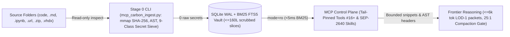

<p align="left">
  
</p>

# Alpha MCP — Stage 0 Carbon Local Research Vault & Inference Layer

**Author:** `Eloquent` (`@mjeanhudson-dev`) · **Runtime:** Python `3.10+` stdlib only (`0` pip dependencies) · **Storage:** SQLite WAL + BM25 FTS5 · **Plugin:** Native `/alpha-mcp` skill (`plugin.json` + `.claude-plugin/plugin.json`)

**Alpha MCP** is a zero-dependency, local-first Stage 0 indexing CLI and unified inference architecture for developers and AI engineering teams. It turns sprawling folders of source code, Markdown specs, Jupyter notebooks, Chrome `.url` bookmarks, `.zip` archives, and `.vhdx` virtual disks into a sub-5ms, secret-scrubbed **SQLite WAL + BM25 FTS5** vault ready to wire into any Model Context Protocol (MCP) server without inflating context windows or leaking credentials.

- **Interactive Walk-Along Guide:** Open [`./walk-along/index.html`](./walk-along/index.html) (4-step interactive simulator covering inspect -> scrub/slice -> BM25 query -> MCP bridge).
- **Hands-On Tutorial & Cookbook:** Read [`./USER_TUTORIAL_GUIDE.md`](./USER_TUTORIAL_GUIDE.md) for the 60-second quick start, Stage 0 best practices, PowerShell/Bash FTS5 escaping rules, and production extensions.

---

## 60-Second Quick Start

Run Alpha MCP out of the box against the bundled, self-contained [`./examples/sample_workspace/`](./examples/sample_workspace/) fixture (zero `pip install` required):

```bash
# ==============================================================================
# LABEL:               Alpha MCP 60-Second Sample Vault Quick Start
# USE:                 Verify zero-dependency Stage 0 ingestion, SHA-256 deduplication, secret redaction, AST extraction, and BM25 FTS5 search on ./examples/sample_workspace.
# MECHANISM_OF_ACTION: Invokes mcp_carbon_ingest.py (Python 3.10+ stdlib) to build a temporary SQLite WAL + FTS5 database, inspect redaction/link audit summaries, and run ranked BM25 searches.
# ==============================================================================
python ./mcp_carbon_ingest.py ingest --roots ./examples/sample_workspace --db ./sample_vault.sqlite3
python ./mcp_carbon_ingest.py audit --db ./sample_vault.sqlite3
python ./mcp_carbon_ingest.py query 'mcp' --db ./sample_vault.sqlite3 --top 5
python ./mcp_carbon_ingest.py query 'ast_summary:LocalResearchMCPServer' --db ./sample_vault.sqlite3 --top 5
```

Expected deterministic receipt (matches [`./examples/sample_ingest_report.json`](./examples/sample_ingest_report.json)):

```text
[CARBON_STAGE_0_RECEIPT] vault=sample_vault.sqlite3 parity=5ee0d39b62b63f02 elapsed=0.31s ...
[METRICS] files=6 dedup_shunted=1 slices_160L=4 links=9 vhdx_entries=0 zip_entries=0
[SECURITY_SIEVE] secrets_redacted=2 fts5_active=True status=SCRUBBED_SAFE_INDEX
```

---

## Architecture at a Glance



### Core Capabilities

- **Zero-Copy `mmap` SHA-256 Deduplication:** Streams `4 MiB` windows to detect byte-identical files across multiple roots and shunts duplicates (`is_duplicate = 1`) before FTS5 chunking.
- **Pre-Index Secret Sieve:** Scrubs `9` high-confidence credential classes (`GOOGLE_API_KEY`, `GOOGLE_OAUTH_TOKEN`, `ANTHROPIC_KEY`, `OPENAI_KEY`, `GITHUB_TOKEN`, `AWS_ACCESS_KEY`, `SLACK_TOKEN`, `PRIVATE_KEY`, `ENV_SECRET`) prior to indexing and records metadata-only counts/lines in `secret_audit`.
- **Deterministic `<= 160`-Line AST Slicing:** Parses Python AST skeletons *before* redaction so `ast_summary` stays syntactically accurate, strips bloated base64 outputs from Jupyter `.ipynb` cells natively, and slices text into bounded `<= 160`-line chunks.
- **Zero-Extraction Archive & Disk Inspection:** Lists internal entries of `.zip` archives via stdlib `zipfile` (`zip_manifest`) and `.vhdx` virtual disks via optional `7-Zip` `7z l -slt` (`vhdx_manifest`) without unpacking gigabytes onto disk.
- **KV-Prefix-Safe MCP Blueprint:** Appends vault retrieval tools strictly at the wire tail (`capabilities.tools.listChanged = false`) to preserve 100% frontier prompt cache hits.

---

## Repository Map

| Path | Description |
| --- | --- |
| [`./mcp_carbon_ingest.py`](./mcp_carbon_ingest.py) | Zero-dependency Python `3.10+` Stage 0 CLI (`ingest`, `query`, `audit`) |
| [`./walk-along/index.html`](./walk-along/index.html) | Interactive 4-step Walk-Along Guide & visual simulator |
| [`./USER_TUTORIAL_GUIDE.md`](./USER_TUTORIAL_GUIDE.md) | Hands-on Quick Start, Stage 0 best practices, PowerShell/Bash BM25 cookbook & production extensions |
| [`./MASTER_COMPENDIUM.md`](./MASTER_COMPENDIUM.md) | Progressive LOD 0 -> LOD 1 -> LOD 2 KPPC compendium & Reference Workstation Benchmark ledger |
| [`./INFERENCE_LAYER_SPEC.md`](./INFERENCE_LAYER_SPEC.md) | Unified Stage 0 -> MCP/A2A -> Apex Contactor -> 25:1 Compaction -> Optional Phase-2 Databricks spec |
| [`./FIRST_LIVE_PUSH_PLAN.md`](./FIRST_LIVE_PUSH_PLAN.md) | Release readiness matrix, binary/secret quarantine boundaries, and execution runbook |
| [`./examples/sample_workspace/`](./examples/sample_workspace/) | Self-contained 6-file runnable demo workspace (`demo_mcp_server.py`, dedup copy, `.md`, `.ipynb`, `.url`, safe redaction fixture) |
| [`./examples/sample_ingest_report.json`](./examples/sample_ingest_report.json) | Verified reference output for the bundled sample workspace (`parity=5ee0d39b62b63f02`) |
| [`./.gitignore`](./.gitignore) | Strict hygiene exclusions (`*.sqlite3*`, `*.vhdx`, `*.pdf`, `*.zip`, `*.pkl`, local audit files, caches) |

---

## Reference Workstation Benchmark

In addition to the 6-file quick-start fixture, `mcp_carbon_ingest.py` was benchmarked against a multi-root local research corpus (full anonymized ledger in [`MASTER_COMPENDIUM.md`](./MASTER_COMPENDIUM.md)):

| Benchmark Metric | Verified Result |
| --- | --- |
| Ingest Elapsed Time (`15` workers, `--vhdx-mode inspect`) | `0.72` s (`parity=7bbc4e68e2f5358f`) |
| Indexed Text / Code Files | `19` (`16` unique SHA-256, `3` dedup-shunted, `3.162` MB) |
| Scrubbed `<= 160`-Line FTS5 Slices | `325` (`4.09` MB SQLite WAL vault, `0` unredacted secrets) |
| Harvested URLs (`web`, `git`, `notebook/MCP`) | `282` records (`238` unique URLs) |
| Zero-Extraction `.zip` Manifest Entries | `547` files across `8` archives (`30.89` MB compressed) |
| Zero-Unpack `.vhdx` Manifest Entries | `3` GPT entries across `2` disks (`616.0` MB physical; `0` B unpacked) |
| Pre-Index Secret Sieve Redactions | `31` hits across `7` raw files (`28` `ENV_SECRET`, `2` `GOOGLE_OAUTH_TOKEN`, `1` `ANTHROPIC_KEY`) |

---

## Public Hygiene & Security Policy

- **Zero Raw Secrets & Zero OS Path Leakage:** All tracked files are verified with `--strict-agnostic` pre-push checks confirming zero credentials, zero local OS usernames, zero hardcoded absolute home paths (normalized to `~/`), and valid GFM tables.
- **Quarantined Binaries Stay Local:** `.sqlite3*` vaults, `.vhdx` disk images, `.pdf` bundles, `.zip` backups, `.pkl` pickles, and raw files flagged by `secret_audit` are excluded by `.gitignore` and never committed to public repositories.
