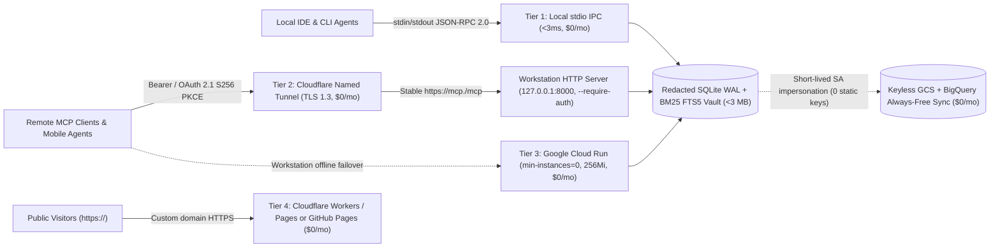

# Alpha MCP v2.0 — Zero-Cost Sovereign Dual-Modality Online Architecture

**Author:** `Eloquent` (`@mjeanhudson-dev`) · **Runtime:** Python `3.10+` stdlib only (`0` pip dependencies) · **Target Spend:** `$0.00/mo` recurring infrastructure (`~$12/yr` domain registration only)

This operational blueprint shows how to run **Alpha MCP v2.0** (Dual-Modality `stdio` + authenticated `Streamable HTTP`, OAuth 2.1 `S256` PKCE, signed Google A2A `v1.0.1`, SEP-2640 atomic skills) and a custom-domain developer web portal online for **`$0.00/mo`** using strictly Always-Free cloud tiers, keyless authentication, and zero-trust ingress.

---

## 1. Dual-Modality & Edge Topology



---

## 2. Architecture & Cost Matrix

| Tier | Deployment Surface | Monthly Cost | Latency / Scaling | Key Invariants & Operational Role |
| --- | --- | --- | --- | --- |
| Tier 1 | Local `stdio` (`alpha_mcp_server.py --transport stdio`) | `$0.00/mo` | `<3 ms` IPC, local process | Primary desktop IDE/CLI transport (`plugin.json` default); zero exposed ports; direct read-only SQLite WAL access |
| Tier 2 | Workstation Streamable HTTP + Cloudflare Named Tunnel | `$0.00/mo` | `15–60 ms` edge RTT, always-ready while workstation is awake | Zero Trust Free Tier TLS 1.3 ingress at `https://mcp.<your-domain>/mcp`; permanent hostname eliminates Quick Tunnel rotation, `CONNECTION_CLOSED`, per-tool "Always Allow" resets, and gateway `@`-menu unmounting |
| Tier 3 | Google Cloud Run Serverless Failover (`Dockerfile`) | `$0.00/mo` | Cold start `~0.6s`, scales `0 -> 2` | `--min-instances=0`, `--max-instances=2`, `--memory=256Mi`, `--cpu-throttling` within Always-Free quota (`2M` req/mo, `180k` vCPU-s, `360k` GiB-s); keyless SA impersonation (`0` static keys on disk) + `<3 MB` scrubbed vault sync to GCS/BigQuery Always-Free |
| Tier 4 | Static Edge Web Hosting (Cloudflare Workers/Pages or GitHub Pages) | `$0.00/mo` | Global edge CDN (`<30 ms`) | Replaces `$23–$36/mo` paid CMS Code-Injection / Business plans; custom domain HTTPS via Cloudflare Free DNS (`~$12/yr` registrar renewal only) |

### Why Cloudflare Named Tunnels Replace Ephemeral Quick Tunnels

Ephemeral Quick Tunnels (`cloudflared tunnel --url http://127.0.0.1:8000`, issuing random `*.trycloudflare.com` subdomains) cause four cascading MCP client failures:

1. **URL Rotation on Restart:** Every reboot or process restart mints a new random hostname, breaking saved MCP server configurations across desktop, web, and mobile clients.
2. **Mid-Session `CONNECTION_CLOSED` Drops:** Unbound Quick Tunnels lack persistent edge routing state, triggering abrupt transport disconnects during tool execution.
3. **Per-Tool "Always Allow" Approval Resets:** MCP clients scope user tool approvals to the server origin; each rotated hostname forces the operator to re-approve every tool from scratch.
4. **Gateway `@`-Menu Unmounting:** Agent workspaces that index remote MCP resources unmount the server from the `@` mention menu as soon as the stale ephemeral origin fails health/reconnect checks.

Binding a **Cloudflare Named Tunnel** (`<your-tunnel-name>` -> `mcp.<your-domain>`) gives a permanent TLS 1.3 origin at **`$0.00/mo`** on the Cloudflare Free Plan and eliminates all four failure modes.

---

## 3. Security & Fail-Closed Auth Fabric

| Layer | Enforcement Mechanism | Requirement |
| --- | --- | --- |
| Non-Loopback Auth Airlock | `--require-auth` + automatic proxy header detection (`X-Forwarded-Host`, `Cf-Visitor`, `X-Forwarded-For`, non-loopback `Host`) | Unauthenticated `POST /mcp` and `DELETE /mcp` return HTTP `401` with `WWW-Authenticate: Bearer resource_metadata="<base>/.well-known/oauth-protected-resource"` |
| Bearer Token Auth | `ALPHA_MCP_BEARER_TOKEN` verified via `hmac.compare_digest` | Mandatory before starting `deploy/Start-DualModalityEdge.ps1` or Cloud Run |
| OAuth 2.1 `S256` PKCE | RFC 9728 protected-resource metadata, RFC 8414 auth-server metadata, `/oauth/authorize` gated by `ALPHA_MCP_OAUTH_SECRET` (or Bearer), `/oauth/token` (`S256` code verifier, single-use code, refresh rotation), RFC 7009 `/oauth/revoke` | Rejects missing/invalid `ALPHA_MCP_OAUTH_SECRET` with HTTP `403`, code replay with HTTP `400 invalid_grant`, and revoked tokens immediately with HTTP `401` |
| Signed A2A `v1.0.1` Card | `GET /.well-known/agent-card.json` signed with `HS256-SOVEREIGN` HMAC using `ALPHA_MCP_SIGNING_SECRET` (or per-boot `secrets.token_bytes(32)`) | Zero static hardcoded signing secrets anywhere in source or container layers |
| Secret Airlock & Sieve | 13-pattern regex redaction over every tool output + `SECRET_PATH_AIRLOCK_DENY` on `.env`, `.pem`, `.key`, OAuth JSON | Raw credentials cannot exit MCP tool responses or enter GCS/BigQuery vault syncs |
| Keyless Cloud IAM | Short-lived `gcloud` service-account impersonation (`GOOGLE_IMPERSONATE_SERVICE_ACCOUNT`) | `0` static service-account JSON key files downloaded to disk |

---

## 4. Hidden Billing Traps & Guardrails Checklist

Audit every item below before declaring a `$0.00/mo` deployment complete:

- [ ] **No Ephemeral Quick Tunnels in Production MCP Configs:** Replace any `*.trycloudflare.com` URL with a Named Tunnel CNAME (`mcp.<your-domain>`).
- [ ] **Cloud Billing Budget Alert (`$25/mo` Ceiling):** Create a GCP Cloud Billing Budget capped at `$25/mo` (or lower) with `50%`, `90%`, and `100%` email alert thresholds so any misconfiguration triggers immediate notification.
- [ ] **Zero Hourly Managed Database Meters:** Never attach AlloyDB, Cloud Spanner, Cloud Bigtable, or always-on Cloud SQL instances for a `<3 MB` research vault. Use local SQLite WAL + FTS5 and optional keyless exports to Cloud Storage Standard (5 GB Always-Free in US multi/regional eligible zones) and BigQuery Sandbox/Always-Free (10 GB storage, 1 TB queries/mo).
- [ ] **Delete Orphaned Stopped-VM Boot Disks (`~$0.40/10GB/mo`):** Stopping a Compute Engine VM halts CPU charges, but attached `pd-standard` boot disks continue accruing `~$0.04/GB/mo` (`~$0.40/mo` per 10 GB disk). Delete unused terminated VMs and unattached disks.
- [ ] **Cancel Auto-Attached Paid Workspace / Email Seat Trials:** When linking a custom domain to Google Cloud Organization / Admin Console, check `Billing > Subscriptions` and cancel any auto-enrolled paid Google Workspace Business trial while keeping **Cloud Identity Free (`$0.00/mo`)** active. Route custom domain mail (`*@<your-domain>`) via **Cloudflare Email Routing (`$0.00/mo`)**.
- [ ] **Enforce Cloud Run Scale-to-Zero Flags:** Always deploy with `--min-instances=0 --max-instances=2 --memory=256Mi --cpu-throttling` in a Tier-1 Always-Free region (`us-east1`, `us-central1`, or `us-west1`). Setting `--min-instances=1` immediately incurs idle instance billing.
- [ ] **Avoid Paid CMS Code-Injection Tiers (`$23–$36/mo`):** Move DNS nameservers to Cloudflare Free Plan and serve static websites/walk-alongs from Cloudflare Workers/Pages or GitHub Pages at `$0.00/mo` instead of upgrading a domain registrar into a paid CMS Business tier.

---

## 5. Labeled Copy-Paste Runbooks

### Runbook A: Permanent Cloudflare Named Tunnel + Local Edge Launch

Create the Named Tunnel once and bind `mcp.<your-domain>` in Cloudflare DNS:

```bash
# ==============================================================================
# LABEL:               Provision Cloudflare Named Tunnel and DNS Route
# USE:                 Create a permanent TLS 1.3 Zero Trust Free Tier tunnel for mcp.<your-domain> to eliminate Quick Tunnel URL rotation and MCP approval resets.
# MECHANISM_OF_ACTION: Authenticates cloudflared against your Cloudflare zone, creates a named tunnel UUID stored locally in ~/.cloudflared, and writes a proxied CNAME record routing mcp.<your-domain> to <tunnel-uuid>.cfargotunnel.com.
# ==============================================================================
cloudflared tunnel login
cloudflared tunnel create <your-tunnel-name>
cloudflared tunnel route dns <your-tunnel-name> mcp.<your-domain>
```

Launch the authenticated Streamable HTTP server and bind the Named Tunnel on Windows (PowerShell):

```powershell
# ==============================================================================
# LABEL:               Launch Authenticated Dual-Modality Edge Server via PowerShell Helper
# USE:                 Start alpha_mcp_server.py with --require-auth on loopback, verify /health is ONLINE, and attach the Cloudflare Named Tunnel.
# MECHANISM_OF_ACTION: Generates ephemeral high-entropy bearer/OAuth/signing secrets in process environment (replace with your secret manager values for stable clients), then executes deploy/Start-DualModalityEdge.ps1 which polls /health and supervises cloudflared tunnel run.
# ==============================================================================
$env:ALPHA_MCP_BEARER_TOKEN   = "<your-long-random-bearer-token>"
$env:ALPHA_MCP_OAUTH_SECRET   = "<your-long-random-oauth-secret>"
$env:ALPHA_MCP_SIGNING_SECRET = "<your-long-random-signing-secret>"

./deploy/Start-DualModalityEdge.ps1 -Port 8000 -TunnelName "<your-tunnel-name>" -VaultDb "./mcp_alpha_vault.sqlite3"
```

Equivalent launch on Linux/macOS (Bash):

```bash
# ==============================================================================
# LABEL:               Launch Authenticated Dual-Modality Edge Server on POSIX
# USE:                 Start alpha_mcp_server.py in --transport http --require-auth mode, verify /health reports ONLINE, and bind the Named Tunnel on Linux or macOS.
# MECHANISM_OF_ACTION: Exports fail-closed auth secrets, runs alpha_mcp_server.py bound to 127.0.0.1:8000 in the background with an EXIT trap for cleanup, waits for /health HTTP 200, and executes cloudflared tunnel run.
# ==============================================================================
export ALPHA_MCP_BEARER_TOKEN="<your-long-random-bearer-token>"
export ALPHA_MCP_OAUTH_SECRET="<your-long-random-oauth-secret>"
export ALPHA_MCP_SIGNING_SECRET="<your-long-random-signing-secret>"
export ALPHA_MCP_VAULT_DB="./mcp_alpha_vault.sqlite3"

python ./alpha_mcp_server.py --transport http --host 127.0.0.1 --port 8000 --require-auth &
SERVER_PID=$!
trap 'kill "${SERVER_PID}" 2>/dev/null || true' EXIT

until curl -sf http://127.0.0.1:8000/health | grep -q '"ONLINE"'; do sleep 0.5; done
cloudflared tunnel run --url http://127.0.0.1:8000 <your-tunnel-name>
```

---

### Runbook B: Keyless Google Cloud Run `$0.00/mo` Failover Deploy

Deploy the non-root `Dockerfile` directly from the repository root with scale-to-zero Always-Free guardrails and keyless Service Account identity:

```bash
# ==============================================================================
# LABEL:               Deploy Alpha MCP v2.0 to Google Cloud Run (Scale-to-Zero Always-Free)
# USE:                 Provision a serverless HTTPS failover MCP endpoint at $0.00/mo within Google Cloud Run Always-Free quotas without storing static JSON keys on disk.
# MECHANISM_OF_ACTION: Builds the non-root python:3.12-slim Dockerfile via Cloud Build, deploys to us-east1 with min-instances=0, max-instances=2, 256Mi RAM, and cpu-throttling, attaches the keyless worker service account, and injects auth secrets from environment or Secret Manager.
# ==============================================================================
export GOOGLE_CLOUD_PROJECT="<your-project-id>"
export WORKER_SA="<worker>@<your-project-id>.iam.gserviceaccount.com"

gcloud run deploy alpha-mcp \
  --project="${GOOGLE_CLOUD_PROJECT}" \
  --source="." \
  --region="us-east1" \
  --platform="managed" \
  --allow-unauthenticated \
  --service-account="${WORKER_SA}" \
  --min-instances=0 \
  --max-instances=2 \
  --memory="256Mi" \
  --cpu=1 \
  --cpu-throttling \
  --concurrency=20 \
  --set-env-vars="GOOGLE_CLOUD_PROJECT=${GOOGLE_CLOUD_PROJECT},GOOGLE_IMPERSONATE_SERVICE_ACCOUNT=${WORKER_SA}" \
  --set-secrets="ALPHA_MCP_BEARER_TOKEN=alpha-mcp-bearer:latest,ALPHA_MCP_OAUTH_SECRET=alpha-mcp-oauth:latest,ALPHA_MCP_SIGNING_SECRET=alpha-mcp-signing:latest"
```

> **Note:** `--allow-unauthenticated` only permits HTTPS requests to reach the Cloud Run container so RFC 9728 / A2A `/.well-known/*` discovery and `/health` remain inspectable while `alpha_mcp_server.py --require-auth` enforces fail-closed Bearer / OAuth 2.1 `S256` PKCE authentication on `POST /mcp` and `DELETE /mcp`.

Optional keyless sync of your `<3 MB` redacted vault to Cloud Storage + BigQuery Always-Free tiers:

```bash
# ==============================================================================
# LABEL:               Keyless Redacted Vault Sync to GCS and BigQuery Always-Free
# USE:                 Export the scrubbed SQLite FTS5 vault (never raw unredacted files) to Cloud Storage and BigQuery using short-lived SA impersonation with zero static key files.
# MECHANISM_OF_ACTION: Runs mcp_carbon_ingest.py sync first in dry-run mode to verify zero unredacted secrets, then with --apply to upload via HTTPS REST using a short-lived impersonated access token and verify BigQuery row counts.
# ==============================================================================
export GOOGLE_CLOUD_PROJECT="<your-project-id>"

python ./mcp_carbon_ingest.py sync --target gcp --db ./mcp_alpha_vault.sqlite3 \
  --bucket "<your-bucket>" --impersonate-sa "<worker>@<your-project-id>.iam.gserviceaccount.com"

python ./mcp_carbon_ingest.py sync --target gcp --db ./mcp_alpha_vault.sqlite3 \
  --bucket "<your-bucket>" --impersonate-sa "<worker>@<your-project-id>.iam.gserviceaccount.com" --apply
```

---

### Runbook C: End-to-End Bearer Token & OAuth 2.1 `S256` PKCE Verification

Run these deterministic probes against either `http://127.0.0.1:8000` or `https://mcp.<your-domain>`:

```bash
# ==============================================================================
# LABEL:               Verify Health, Signed A2A Card, Fail-Closed 401, and Bearer MCP Call
# USE:                 Prove end-to-end that discovery routes respond 200, unauthenticated /mcp is rejected with 401 + WWW-Authenticate, and authenticated Bearer /mcp executes sovereign_dual_modality_status.
# MECHANISM_OF_ACTION: Issues sequential curl requests against /health, /.well-known/agent-card.json, unauthenticated POST /mcp (asserting HTTP 401), and Bearer-authenticated POST /mcp invoking tools/call for sovereign_dual_modality_status.
# ==============================================================================
export BASE_URL="https://mcp.<your-domain>"
export ALPHA_MCP_BEARER_TOKEN="<your-long-random-bearer-token>"

# 1. Public health & signed A2A v1.0.1 Agent Card (expect HTTP 200)
curl -sf "${BASE_URL}/health"
curl -sf "${BASE_URL}/.well-known/agent-card.json"

# 2. Fail-closed check: unauthenticated POST /mcp MUST return HTTP 401 + WWW-Authenticate
curl -i -s -X POST "${BASE_URL}/mcp" \
  -H "Content-Type: application/json" \
  -d '{"jsonrpc":"2.0","id":1,"method":"tools/list"}'

# 3. Authenticated Bearer POST /mcp (expect HTTP 200 with 10-tool status payload)
curl -sf -X POST "${BASE_URL}/mcp" \
  -H "Authorization: Bearer ${ALPHA_MCP_BEARER_TOKEN}" \
  -H "Content-Type: application/json" \
  -d '{"jsonrpc":"2.0","id":2,"method":"tools/call","params":{"name":"sovereign_dual_modality_status","arguments":{}}}'
```

Verify the complete OAuth 2.1 `S256` PKCE flow (authorize -> token -> `/mcp` -> single-use replay rejection -> `/oauth/revoke` -> `401`) using Python stdlib only:

```bash
# ==============================================================================
# LABEL:               End-to-End OAuth 2.1 S256 PKCE & Revocation Probe
# USE:                 Validate RFC 9728/8414 discovery, gated /oauth/authorize, S256 PKCE code exchange at /oauth/token, Bearer access to /mcp, single-use code replay rejection, and RFC 7009 /oauth/revoke enforcement.
# MECHANISM_OF_ACTION: Executes an inline Python 3.10+ stdlib probe that computes an S256 code_challenge, calls /oauth/authorize with X-Alpha-OAuth-Secret, exchanges the code at /oauth/token, calls POST /mcp, revokes the token at /oauth/revoke, and asserts subsequent /mcp calls fail with HTTP 401.
# ==============================================================================
BASE_URL="https://mcp.<your-domain>" ALPHA_MCP_OAUTH_SECRET="<your-long-random-oauth-secret>" python - <<'PY'
import base64, hashlib, json, os, secrets, urllib.error, urllib.parse, urllib.request

base = os.environ["BASE_URL"].rstrip("/")
secret = os.environ["ALPHA_MCP_OAUTH_SECRET"]
verifier = secrets.token_urlsafe(32)
challenge = base64.urlsafe_b64encode(hashlib.sha256(verifier.encode()).digest()).rstrip(b"=").decode()

# 1. Request authorization code (gated by X-Alpha-OAuth-Secret)
auth_body = json.dumps({
    "client_id": "verify-cli",
    "redirect_uri": "http://127.0.0.1/cb",
    "code_challenge": challenge,
    "code_challenge_method": "S256",
    "response_type": "code",
}).encode()
req = urllib.request.Request(
    f"{base}/oauth/authorize",
    data=auth_body,
    method="POST",
    headers={"Content-Type": "application/json", "X-Alpha-OAuth-Secret": secret},
)
with urllib.request.urlopen(req, timeout=15) as r:
    code = json.loads(r.read())["code"]

# 2. Exchange authorization code with S256 verifier
tok_body = urllib.parse.urlencode({
    "grant_type": "authorization_code",
    "code": code,
    "code_verifier": verifier,
    "client_id": "verify-cli",
    "redirect_uri": "http://127.0.0.1/cb",
}).encode()
with urllib.request.urlopen(urllib.request.Request(f"{base}/oauth/token", data=tok_body, method="POST"), timeout=15) as r:
    tok = json.loads(r.read())["access_token"]

# 3. Call /mcp using OAuth 2.1 access token (expect 200)
mcp_req = urllib.request.Request(
    f"{base}/mcp",
    data=json.dumps({"jsonrpc": "2.0", "id": 1, "method": "ping"}).encode(),
    method="POST",
    headers={"Authorization": f"Bearer {tok}", "Content-Type": "application/json"},
)
with urllib.request.urlopen(mcp_req, timeout=15) as r:
    assert r.status == 200

# 4. Revoke token (RFC 7009) and verify subsequent call fails with 401
rev_body = urllib.parse.urlencode({"token": tok}).encode()
urllib.request.urlopen(urllib.request.Request(f"{base}/oauth/revoke", data=rev_body, method="POST"), timeout=15).read()
try:
    urllib.request.urlopen(mcp_req, timeout=15)
    raise AssertionError("Expected HTTP 401 after revocation")
except urllib.error.HTTPError as exc:
    assert exc.code == 401

print("OAUTH_2_1_S256_PKCE_AND_REVOKE_VERIFIED: PASS")
PY
```

---

### Runbook D: Residual GCP Disk & Billing Guardrail Audit

```bash
# ==============================================================================
# LABEL:               Audit Orphaned Compute Disks and Active GCP Billing Budgets
# USE:                 Identify terminated VMs, unattached persistent disks (~$0.40/10GB/mo), and verify a $25/mo Cloud Billing Budget alert is active.
# MECHANISM_OF_ACTION: Queries gcloud compute instances, gcloud compute disks, and gcloud billing budgets in read-only mode so orphaned storage or missing budget ceilings are surfaced before generating bills.
# ==============================================================================
export GOOGLE_CLOUD_PROJECT="<your-project-id>"
export BILLING_ACCOUNT_ID="<your-billing-account-id>"

gcloud compute instances list --project="${GOOGLE_CLOUD_PROJECT}" --format="table(name,zone,status,disks[].source)"
gcloud compute disks list --project="${GOOGLE_CLOUD_PROJECT}" --format="table(name,zone,sizeGb,type.basename(),users)"
gcloud billing budgets list --billing-account="${BILLING_ACCOUNT_ID}"
```
